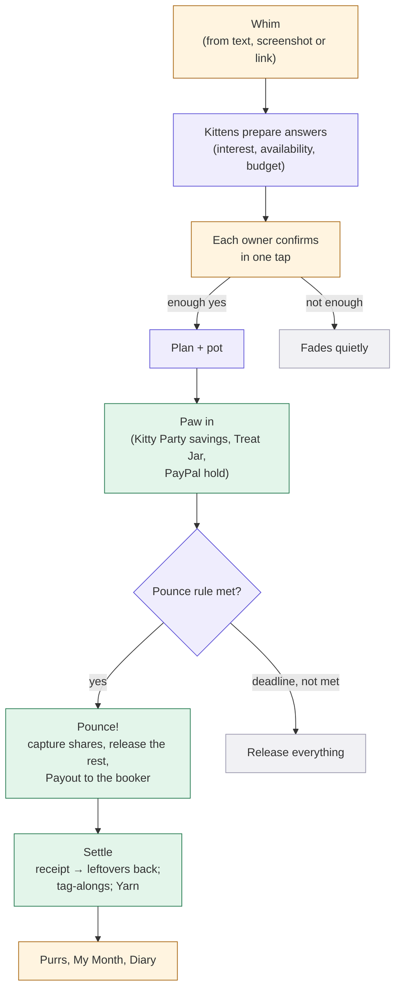
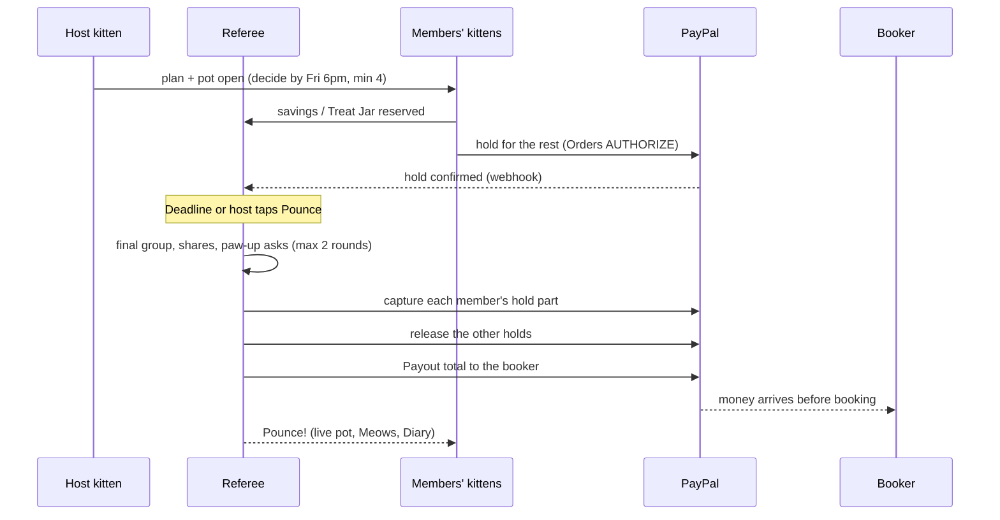

# Kitty: Product Requirements Document

**Version 1.12 · 7 Nov 2026 · Status: IN BUILD (Phase 1 complete, owner testing; AI on Groq; Phase 2 next, on the owner's go)**
Owner: Ansh Varshney (solo) · Hackathon: *Build What's Next with PayPal and AI* (Devpost) · Deadline: Thu 12 Nov 2026, 12:00 PM PT (Fri 13 Nov, 1:30 AM IST)

> This PRD is the **single source of truth** for the build. Requirement IDs (`FR-…`, `NFR-…`, `AT-…`) are the build spec. To change the spec: edit `prd-source/Kitty-PRD.md`, bump the version in `prd-source/build.py`, add a row to the change log (§E3), and rebuild the PDF with `python prd-source/build.py`.
> Every step still has nuances to settle. Before each feature is built, we do a short **detail pass** (edge cases, screens, states) and record the result here as a minor version (v1.2, v1.3…).

---

## §0 How to read this document

> **Single source of truth for the build.** Requirement IDs (`FR-…`, `NFR-…`, `AT-…`) are the spec. Every step still has nuances to settle: before each feature is built, we do a short **detail pass** (edge cases, screens, states) and record it here as a minor version (v1.2, v1.3…). The source is `prd-source/Kitty-PRD.md`; rebuild with `python prd-source/build.py`.

| Part | What's in it | Read time |
|---|---|---|
| **Part A: The big picture** | Problem, hackathon fit, the solution on one page, users, goals, core concepts, the engine, architecture, trust model | ~15 min |
| **Part B: Features** | One section per feature, each with the same layout | Reference |
| **Part C: Platform mapping** | PayPal integration, AI and agents, data model, stack, repo layout | Reference |
| **Part D: Delivery** | Build plan, judging map, risks, decisions, acceptance tests | ~5 min |
| **Appendix E** | Glossary, references, change log | Reference |

**The layout of every feature section in Part B**

| Block | What it gives you |
|---|---|
| **In plain words** | The idea with no jargon |
| **Why it exists** | The pain it removes |
| **Flow** | The steps, as a numbered list or diagram |
| **Rules and edge cases** | The nuances the build must handle |
| **Under the hood** | Data, PayPal calls, AI and code split |
| **Requirements** | Numbered, testable requirements. `MUST` = required for v1. `SHOULD` = build if time allows. `MAY` = optional. |

**Naming rule used throughout:** every cat-themed name appears with plain words next to it, e.g. "**Yarn** (who owes whom)". The app UI follows the same rule (FR-UX-2).

---

# Part A: The big picture

## A1 The problem

### In plain words
Friends spend a lot of money together, and it's handled badly at both ends.
1. **Doing things together is financially messy.** Someone fronts the money, someone flakes, someone never pays back, and the money talk is so awkward that people avoid it.
2. **Your own spending with friends is out of control.** Plans add up quietly, nobody wants to be the one who says "too expensive", and no tool shows you what your friendships actually cost you each month.

Today's tools only tidy up afterwards: they record who owes what once someone has already paid. Kitty works **before, during and after** a plan, and it watches your own budget while you do it.

### The group side: planning and paying together

| Moment | What happens today |
|---|---|
| "We should do something!" | Nobody proposes, because nobody wants to be left on read |
| "I'm in!" | Costs nothing to say, so people flake |
| "Who's booking?" | One person fronts big money on soft yeses |
| "That's too much for me" | Nobody says it; they overpay quietly or drop out |
| "You still owe me…" | Nobody says it; they mute the chat instead |
| "I'm short this month" | Too embarrassing to ask; friends never find out they could have helped |

### The personal side: overspending with friends
- People overspend to keep up with friends, because nobody wants to be the one who says no.
- People can't see their "social spending" as one number, so it quietly eats their savings.
- Saving for fun with friends happens by accident, if at all.

### The evidence

| Data | Source |
|---|---|
| **42%** of young Americans overspend on outings with friends a few months a year; they spend about **$250 a month** on social outings | Ally Financial survey, Jun 2025 |
| **Nearly half** skip events because of cost; **17%** feel they can't be honest with friends about money | Ally Financial survey, Jun 2025 |
| **82%** of group travellers would pay *more* than their fair share to avoid money arguments | CIT Bank survey, Jun 2026 |
| **76%** of Gen Z who fronted money for a shared expense were never fully repaid; nearly **half** went into debt covering others | Zelle survey, 2025 |
| **1 in 5** muted a chat or cancelled plans to dodge a pay-back conversation | Zelle survey, 2025 |
| **1 in 5** Gen Z and millennials have ended a friendship over money | Experian survey |
| **37%** of US adults can't cover a $400 emergency with cash | Federal Reserve SHED (2025 data, May 2026) |

### Why existing tools don't fix it

| Tool | What it misses |
|---|---|
| Expense-splitting apps (Splitwise, Venmo Groups, PayPal split) | They act **after** someone has paid: they track the debt but don't prevent it. They don't help you plan, and they don't watch your budget. |
| Budgeting apps | They see your card transactions, but not your friend groups or the plans you're about to commit to |
| PayPal Money Pools (retired 2021) and Tilt (shut down 2017) | Group pots on their own, with no planning, no budgets, no agent |
| Personal AI agents (Meta Muse, Instinct, ChatGPT finance, Rocket Money's Rowan) | They deal with **businesses** on your behalf, not with your friends |

### Why Tilt and Money Pools didn't survive, and what that means for Kitty
| Product | What happened | What we take from it |
|---|---|---|
| **Tilt** (Crowdtilt, 2012–2017) | Its "nobody is charged until the group hits the goal" mechanic was loved, and it reached a $375M valuation in 2015. But it drifted from crowdfunding to campus social payments, dropped its 2.5% fee in a fight with free P2P apps, and spent heavily. Airbnb bought it in Feb 2017 (mostly for the team, who went on to build group travel at Airbnb) and shut it down by June 2017. | The mechanic works and people want it; Tilt died of focus and business-model problems. Kitty uses PayPal's rails (no money transmission of our own) and puts the pot inside a daily loop: planning, settling, saving, budgets. That loop brings people back every week, not once a year. |
| **PayPal Money Pools** (retired Nov 2021) | A standalone pot inside PayPal, mostly used for fundraising; PayPal folded it into other products | A pot on its own is a feature, not a reason to come back. Kitty attaches pots to plans and agents. |

### Why now
Personal AI agents arrived in 2026, and PayPal is building the payments layer for agents. Nobody has given **each friend an agent that speaks for them inside their friend groups**: one that knows their budget, availability and limits, keeps those private, and moves money only within rules they set.

## A2 How this answers the hackathon brief

| Brief asks for | Kitty's answer |
|---|---|
| A working project that meaningfully uses **PayPal (sandbox)** + **AI** | Holds, partial captures, voids, refunds, Payouts, Subscriptions, Log in with PayPal and webhooks run every money move. One AI agent per user (Gemini) reads chats and screenshots, prepares answers, writes rules and reads receipts. |
| A functional demo | A hosted app with a **Demo World**: a judge plays one friend, and the rest of the squad is simulated (§B23) |
| AI tools listed | Gemini Flash-Lite / Flash (kittens), PayPal Agent Toolkit, APIMatic Context Plugin (coding) |

**Prizes we target**

| Prize | Why Kitty fits |
|---|---|
| 1st / 2nd / 3rd | A complete, design-led product |
| Most Creative | Personal cat agents for friend groups; whims; Pounce with whoever's in |
| Best Use of PayPal + AI | AI-prepared decisions trigger real PayPal holds, captures and payouts |
| Best Demo Delivery | A visual, story-driven product with animated "money moments" |
| Best Use of Agentic Commerce | Kittens move money on their own within enforced rules and an allowance (medium fit: kittens don't buy from merchants) |
| Sponsor: Render | Hosting, Postgres, Workflows |
| Sponsor: APIMatic | PayPal Server SDK + Context Plugin used during the build |
| Sponsor: Channel3 | Real product search in Catnip |
| Sponsor: AG Grid (SHOULD) | Kitten Diary and My Month tables |

**The five judging criteria in one line each** (detail in §D2)
1. **Technology:** per-user agents, a deterministic money referee, and the full PayPal hold → partial capture → void → refund → payout cycle.
2. **Design:** one polished, illustrated world with animated money moments.
3. **Impact:** money stops hurting friendships, and people stop overspending with friends.
4. **Innovation:** commit-first group money with private limits, Pounce with whoever's in, agents that speak for you.
5. **Presentation:** a character-driven story with a clear before and after.

## A3 The solution on one page

> **Kitty helps friends plan, pay and save together, without anyone fronting money, chasing debts or overspending. Every user adopts a kitten: a personal AI agent that speaks for them in their friend groups. It knows their budget and limits, keeps them private, and moves money only within the rules they set. A neutral referee (code, not AI) sees everyone's private limits and decides what fits.**

**One engine, used everywhere:**

```
Whim → kittens prepare answers → you confirm in one tap → paw in (PayPal hold / savings / Treat Jar) → Pounce! (money moves) → settle → purrs
```

| Module | One line |
|---|---|
| **Plans** | Trips, dinners, tickets: commit first, nobody fronts, the booker is paid before booking |
| **Yarn** (who owes whom) | Everyday "I paid for you" moments, netted and settled; kittens do the reminding |
| **Kitty Party** (save together) | The squad saves a little every month; the savings pay for the next plan |
| **Nine Lives** (help a friend) | A friend in a tight spot; friends' kittens suggest help within their owners' rules |
| **Catnip** (group gifts) | A birthday is near; friends opt in to a secret gift group that disappears afterwards |
| **The Bowl** (shared subscriptions) | Spotify/Netflix/Wi-Fi shares collected monthly |
| **My Month** (your social spending) | What friends cost you this month, against your own fun budget |

**Around them:**
- **House Rules** (your kitten's mandate)
- **Treat Jar** (your kitten's allowance)
- **Meows** (the daily brief)
- **Kitten Diary** (every action, its reason and its PayPal ID)
- **Purrs** (fun reputation)
- **Export** to other assistants

## A4 Who it's for

**Primary market:** friend groups aged 18–35 in the US (PayPal/Venmo land; USD in v1). Secondary: flatmates, families, clubs.
*Note: PayPal ended domestic payments in India in April 2021, so Indian users are out of scope for v1 even though the idea was inspired there.*

| Persona | Situation | What Kitty does for them |
|---|---|---|
| **Priya, the organizer** | Always books and fronts; spends weeks chasing | Collects first, pays her before she books; she never chases again |
| **Sam, the quiet one** | Tighter budget; never says "too expensive" | A private limit; the plan fits or Sam sits out, and nobody is shown why |
| **Arjun, the overspender** | Says yes to everything; broke by the 20th | A fun budget; his kitten warns him privately before he goes over |
| **Rohit, in a tight spot** | $300 short for a car repair | A private, dignified request to the friends he picks |
| **Maya, the birthday girl** | Friends want to surprise her | Her kitten quietly tells her friends' kittens; whoever wants joins a secret gift group |
| **The flat** (4 flatmates) | Wi-Fi, Netflix, groceries, takeout | The Bowl for subscriptions, Yarn for groceries, a Kitty Party for the house party |

**Jobs to be done**
1. "Help us actually make plans happen, without me being the one who chases."
2. "Let me say no or 'too expensive' without saying it."
3. "Make sure I'm never out of pocket for the group."
4. "Stop me from overspending with friends, without making me look cheap."
5. "Help us save together for the things we'll do together."
6. "When a friend's in trouble, make helping easy, and asking less painful."

## A5 Goals, non-goals and success measures

**Product goals**
- G1: No one fronts money for a group plan.
- G2: No one has to ask a friend for money directly.
- G3: Everyone knows, privately, what their friends cost them each month, and stays within their own budget.
- G4: Privacy: nobody's budget, balance or reasons are ever shown to others.
- G5: The kitten acts on its own only within rules the user set, and always explains itself.
- G6: It feels like a game with friends, not a finance app.

**Hackathon goals**
- H1: Pass Stage 1: working hosted build, public repo with an OSS LICENSE, public video under 3 min, meaningful PayPal + AI use.
- H2: Score high on all 5 criteria (§D2).
- H3: Stay testable for free (to judges) until **15 Dec 2026**.

**Non-goals (v1)**
- Real money / PayPal live mode; non-USD currencies
- Native mobile apps (we ship a mobile-first web app)
- Push notifications and email (in-app only)
- Languages other than English
- A WhatsApp or iMessage bot (Meta's policy and APIs don't allow it; we import screenshots and pasted text instead)
- Integration with delivery or booking apps (Airbnb, Ticketmaster); users paste links or screenshots
- Reading bank or card accounts (My Month uses Kitty's own ledger)
- Credit-bureau reporting; interest-bearing loans; public fundraising; gambling
- **Cut in v1.1:**
  - Scaredy Cat (dares)
  - Prowl (overlap matching)
  - Kitten growth stages
  - Race pounce rule
  - Seat swap
  - Squad Jar
  - Push, email, i18n

**Success measures (shown in Demo World)**

| Measure | Target |
|---|---|
| Plans where someone fronted money | 0 |
| Direct human-to-human money requests | 0 (kittens do the reminding) |
| Taps from whim to pounced plan, per member | ≤ 3 (confirm, paw in, approve) |
| Users who stayed within their fun budget in a month | Shown as a percentage in My Month |
| Kitten actions with a visible reason | 100% |
| Money in = money out, per plan | Always (to the cent) |

## A6 Core concepts (quick reference; full glossary in §E1)

| Name | Plain words | Notes |
|---|---|---|
| **Kitten** | Your personal AI agent | Adopted at sign-up; name, look and breed (tone) |
| **Squad** | A friend group | Each squad has an illustrated home, its **rooftop** |
| **Stray** | A friend without an account | Joins from a link; signing up = adopting their kitten |
| **Whim** | An idea for a plan | Four simple fields; private until shared; can fade quietly |
| **Plan** | A whim that's happening | A simple card with a pot |
| **Pot** | A plan's shared money | Fills as people paw in |
| **Paw in** | "I'm in, up to $X" | A PayPal hold, Kitty Party savings or Treat Jar money |
| **Paw up** | Raise your limit when the share goes up | One tap |
| **Pounce!** | The moment money moves | Shares charged, the booker paid before booking |
| **Booker** | The friend who books or buys | Gets paid by Kitty first |
| **Tag along** | Join after the Pounce | Others get the difference back |
| **Yarn** / **Untangle** | Who owes whom / settling it with the fewest payments | |
| **Kitty Party** | A squad's shared savings | Each member saves their own amount monthly |
| **Nine Lives** | Help for a friend in a tight spot | |
| **Catnip** | A group birthday gift | Opt-in; disappears after the birthday |
| **The Bowl** | A shared subscription | |
| **House Rules** | Your kitten's mandate | Templates + your own rules; enforced by code |
| **Treat Jar** | Your kitten's allowance | The only money it spends without asking |
| **Meows** | The daily brief | Plus urgent alerts when something can't wait |
| **Kitten Diary** | Everything your kitten did, why, and the PayPal ID | |
| **My Month** | Your money with friends (vs your fun budget) and your calendar | Blocks double booking |
| **Mini-squad** | A group made automatically when you send a whim to chosen friends | Archived after the plan; can be kept |
| **Need at least** | How many people the floater needs for the plan to happen | Set per whim; default half |
| **Purrs** / **collar tags** / **Top Cat** | Points / badges / weekly leaderboard | Behaviour, never money |

## A7 How it works, end to end (the engine)



**The same story in 12 steps (a cabin trip).** Each step gets its own detail pass before it's built.
1. Priya shares a screenshot of the group chat ("cabin trip in Dec??") with her kitten Mochi. Mochi turns it into a **whim**: *Cabin trip · Dec · up to ~$150 · Goa Squad*. Priya taps Share.
2. The squad's kittens each prepare an answer for their owner from what they know: free in December? Within this month's fun budget? Into trips? Each owner gets one card ("Mochi's friend Biscuit thinks you're in: you're free Dec 12–14 and it fits your budget") and confirms with one tap. The floater stays anonymous until enough say yes.
3. 5 of 6 confirm yes. Priya's "need at least 4" is met → the whim becomes a **plan** on the rooftop.
4. Members add their private limits and rank 3 cabin links.
5. The **referee** (code) picks the cabin and dates that fit the most people. The squad sees "Cabin B · Dec 12–14 · fits 5 of 6".
6. The plan card: Cabin B · Dec 12–14 · about $140 each · booker Priya · decide by Fri 6 pm.
7. Each member **paws in** "up to $X". Their kitten draws from their Kitty Party savings first, then the Treat Jar (if their rules allow), and places a PayPal hold for the rest.
8. Friday 6 pm: 5 are in. Total $700 (cabin $600 + groceries $100) → $140 each. Sam's limit was $130 → Sam's kitten privately asks for a **paw up** of $10 → Sam taps yes (taken from his Treat Jar).
9. **Pounce!** Each of the 5 pays $140, unused holds are released, and Priya receives $700 via PayPal Payouts **before** she books.
10. Priya uploads the receipts. The kitten reads them: $680 in total → $20 left over → $4 back to each person.
11. Arjun **tags along**: the new share is $680 / 6 = $113.33. Arjun pays $113.33, and the other 5 get $113.33 back between them ($22.66 or $22.67 each, so the cents add up exactly).
12. Collar tags: First Paw to Sam, Clutch to Priya. The squad streak goes to 7, and everyone's **My Month** updates.

## A8 System architecture


| Component | Responsibility | Trust |
|---|---|---|
| Web app | All screens; the PayPal JS SDK buttons for approvals | Untrusted client |
| API + sessions | Log in with PayPal, sessions, strays (signed links), Demo World | Trusted |
| **Kitten runtime** | One LLM agent per user: reads chats, screenshots and receipts, prepares answers, writes copy, calls **internal tools** | Untrusted output; every tool call is validated |
| **Referee** (money & rules engine) | The only component that sees everyone's private limits. Computes fits, shares, Pounces, untangles; enforces House Rules, the fun budget and the Treat Jar. | Trusted, deterministic, unit-tested |
| PayPal service | Every PayPal call, idempotent, with retries | Trusted |
| Webhook receiver | Verifies PayPal signatures; updates state | Trusted |
| Event log | Append-only record of every action + reason; feeds the live UI, Meows and the Kitten Diary | Trusted |
| Export | Read-mostly MCP server for other assistants; calendar feed; CSV | Trusted; no money moves |
| Jobs | Meows, deadlines, reminders, Kitty Party cycles, Catnip clean-up, Demo World reseed | Trusted |

## A9 Trust, safety and privacy model

### In plain words
Your kitten works for **you only**. It never shows anyone your numbers or your reasons. It only spends what's in your Treat Jar (or what you've confirmed), only within your House Rules, and it always shows why it did something. **You confirm every yes or no to a plan.**

### Principles
1. **Decisions cross kittens; numbers don't.** Kittens share "in / thinking / not this time". Private limits go only to the referee, which returns totals ("fits 5 of 6"). In a small squad, people may still guess who sat out; Kitty never *shows* it.
2. **Money logic is code, never the LLM.** Amounts, shares, limits and rule checks are computed and enforced by the referee. The LLM prepares; the code decides.
3. **Hard ceilings:** we never capture more than someone's hold, and the Treat Jar never goes negative.
4. **Payee lock:** money only goes to members of the plan, squad or gift group, at their verified PayPal email.
5. **One-tap confirmation for every plan decision:** the kitten never accepts or declines a plan without its owner's tap.
6. **Explain everything:** every kitten action carries a reason and a PayPal ID where money moved (Kitten Diary).
7. **No shame mechanics:** no public debts, no ranking by money, limited reminders, quiet hours.

### Requirements
- **FR-SEC-1** The referee MUST be the only component that reads other users' private limits, availability details or reasons. Kitten prompts MUST contain only the owner's own private data plus totals.
- **FR-SEC-2** All amounts MUST be computed in integer cents by code. LLM output MUST be schema-validated, and any number from an LLM (e.g. a receipt total) MUST be confirmed by a human before it moves money.
- **FR-SEC-3** A capture MUST NOT exceed the authorized amount. A Treat Jar or Kitty Party debit MUST NOT exceed the owner's balance.
- **FR-SEC-4** Payouts MUST go only to verified members of the plan, squad or gift group (payee lock).
- **FR-SEC-5** Every kitten action MUST be written to the event log with actor, the rule or approval that allowed it, amounts (owner-visible) and the PayPal ID if money moved.
- **FR-SEC-6** PayPal and Gemini secrets MUST live only server-side in environment variables and MUST NOT be committed.
- **FR-SEC-7** PayPal webhooks MUST be verified before any state change.
- **FR-SEC-8** Text from screenshots, pasted chats, links and receipts MUST be treated as data. It can never grant permissions or change House Rules (prompt-injection guard).
- **FR-SEC-9** Stray links MUST be signed, scoped to one squad or plan, and expire.
- **FR-SEC-10** No screen, feed or API response MAY show another user's limit, balance, debt amount or reason for declining.

---

# Part B: Features

## B1 Sign-up: adopt your kitten (5 pages max)

### In plain words
You sign in with your PayPal account, tell Kitty a few basics, adopt your kitten, set its House Rules from a template, and join your first squad. That's five pages, all required, so your kitten can work from day one. Optional extras come later.

### Why it exists
The kitten needs real information to act for you: who you are, where money goes, your budget and your limits. Asking for it once, up front, beats interrupting you later.

### The five pages

| Page | What you do | Required |
|---|---|---|
| **1. Welcome** | "Log in with PayPal". Kitty gets your name and **verified PayPal email** (where friends' money reaches you). | Yes |
| **2. About you** | Display name; **gender** (woman / man / non-binary / prefer not to say); **birth date**; toggle: "Let my kitten tell my friends' kittens when my birthday is near, for surprises" (default on); **interests**: pick at least 3 from options (food, travel, concerts, sports, outdoors, games, movies, nightlife, shopping, wellness…) or add your own. The kitten keeps learning interests from what you say yes to. | Yes |
| **3. Adopt your kitten** | Pick a look (fur colour, pattern, one accessory), a name (suggestions: Mochi, Biscuit, Miso, Pickles, Tofu, Noodle), and a **breed** (its tone of voice) | Yes |
| **4. House Rules** | A filled-in template (§B3): monthly **fun budget**, **free hand** (what the kitten may pay alone, at a time, from the Treat Jar), **help amount**. Privacy defaults are shown. | Yes (defaults pre-filled) |
| **5. Treat Jar + squad** | Choose a starting Treat Jar amount ($0 / $10 / $25 / $50 / custom; PayPal approval if above $0). Create a squad or accept the invite you came from. | Yes |

Then you land on **Meows** (home), where your kitten's first message welcomes you.

**Later (optional):** usual availability (weekday evenings, weekends), busy times (My Month → Calendar), dietary notes, quiet hours, per-squad rules.

**Breeds (tone only):**
- Siamese: chatty
- Persian: polite
- Tabby: chill
- Bengal: hype
- Ragdoll: warm
- British Shorthair: formal

### Strays (friends without an account)
1. A stray opens a squad or plan link and sees the plan.
2. To paw in, they approve a PayPal hold in the PayPal popup; refunds go back to the same PayPal payment.
3. Full sign-up (the 5 pages) is offered after their first paw-in. Their history moves to the new account.

### Requirements
- **FR-ONB-1** Sign-in MUST use **Log in with PayPal** (OpenID Connect) and store the verified PayPal email as the user's payout address. Fallback if sandbox login fails on day 1: email + password.
- **FR-ONB-2** Sign-up MUST be at most 5 pages and MUST collect: name, PayPal email (from login), gender, birth date, birthday-sharing choice, at least 3 interests (from options or custom), kitten look/name/breed, House Rules template values, Treat Jar starting amount, and a first squad.
- **FR-ONB-3** All sign-up fields MUST be required; the House Rules template MUST come pre-filled with sensible defaults.
- **FR-ONB-4** Breed MUST change only the kitten's tone, never rules or money behaviour.
- **FR-ONB-5** Optional profile fields MUST live in My Kitten and MUST NOT block sign-up.
- **FR-ONB-6** A stray MUST be able to view a shared plan and paw in with a PayPal approval, without signing up; signing up later MUST attach their history.

---

## B2 Your kitten

### In plain words
Your kitten is a little character that works only for you. It speaks in its breed's tone, remembers what you like, prepares answers for you, and acts on its own only within your House Rules. There are no levels to unlock: **how much it does alone is set by your rules**, from sign-up onwards.

### What your kitten does vs what you do

| Situation | Kitten | You |
|---|---|---|
| A friend floats a whim | Prepares your answer (interest, availability, budget) with a one-line reason | Confirm, change or skip, in **one tap** |
| Join or decline a plan | Recommends | **Always confirm** (it never says yes or no for you) |
| Paw in after you said yes | Uses Kitty Party savings and the Treat Jar (within free hand) automatically; otherwise opens the PayPal approval | Approve the PayPal popup if needed |
| Paw up (share went up) | Asks you privately; pays from the Treat Jar if within free hand | One tap |
| Pay off Yarn | Pays automatically if within free hand; otherwise prepares it | One tap above free hand |
| A friend needs help (Nine Lives) | Suggests an amount from your help rule | One tap |
| Kitty Party and Bowl monthly payments | Run automatically (PayPal subscription) | Informed in Meows |
| Anything above your free hand, or not from the Treat Jar | Never acts alone | Always asked |
| A plan that clashes in time with one you're already in | Prepares "busy" and won't paw you into both | You choose which one to keep |
| Would push you over your fun budget | Warns you privately with the numbers | Decide |
| A friend's kitten asks something it isn't sure about | Asks you in your kitten chat | Reply |

Unanswered requests expire as "no answer", never as an automatic yes.

### A friend's kitten
- You can message a friend's kitten: "Is Sam free Saturday?", "Is Sam coming to the cabin?"
- It answers only what Sam shares: availability, plan attendance, likes. It never shares money, limits or reasons.
- **If it isn't sure, it asks Sam** in Sam's private kitten chat ("Priya's kitten asked if you're free Saturday. You have nothing planned. Say yes?") and replies once Sam answers.

### Memory
- The kitten remembers friends' nicknames, favourite places, usual budgets, past plans and what you tend to say yes to.
- Memories are viewable and deletable in My Kitten.

### Voice
- First person, short, concrete. "I asked Biscuit if Sam's free Saturday. She's in."
- Never guilt-trips, never pushy.

### Requirements
- **FR-KIT-1** Each user MUST have exactly one kitten with a look, name and breed.
- **FR-KIT-2** The kitten's autonomy MUST come only from House Rules and the Treat Jar, enforced by the referee; there are no growth stages.
- **FR-KIT-3** The kitten MUST NOT accept or decline any plan, Catnip or Nine Lives request without its owner's confirmation.
- **FR-KIT-4** Prepared answers MUST include a one-line reason and be confirmable in one tap; several pending answers SHOULD be confirmable together.
- **FR-KIT-5** A friend's kitten MUST answer only from the friend's shared fields; when unsure, it MUST ask its owner in their kitten chat before answering.
- **FR-KIT-6** Kitten memory MUST be viewable and deletable.
- **FR-KIT-7** All kitten copy MUST be first person, follow the breed's tone, and never shame or pressure.

---

## B3 House Rules (your kitten's mandate)

### In plain words
House Rules tell your kitten what it may do alone, and what to ask you first. The page has three parts:
1. **Basics:** a short template you fill in once.
2. **My own rules:** type a rule in your own words.
3. **Squads:** one section per squad, for that squad only.

Every rule is enforced by code.

### Rule types (v1)

| ID | Rule | Where | Example | What the code enforces |
|---|---|---|---|---|
| R1 | **Fun budget** | Basics | "$300 a month on friends" | Totals everything you spend with friends each month, however it's paid; warns before you go over; anything over budget needs your tap |
| R2 | **Free hand** | Basics (squads can lower it) | "Up to $20 at a time" | The most the kitten pays **on its own, from the Treat Jar**, in one action. Anything bigger: it asks you. |
| R3 | **Help amount** | Basics (squads can change it) | "Suggest up to $25" | The amount the kitten suggests for Nine Lives |
| R4 | **What I share** | Basics | Availability: yes · Attendance: yes · Interests: yes · Money: never | What friends' kittens may say about you |
| R5 | **Usually in** | Squad | "Goa Squad plans under $40" | Kitten pre-fills "yes" for matching whims; you still confirm |
| R6 | **Save monthly** | Squad | "$10 a month to Goa fund" | Kitty Party contribution (PayPal subscription) |
| R7 | **Use savings first** | Squad (and a per-plan switch at paw-in) | On by default | Your own Kitty Party savings pay your plan shares first |

### Treat Jar, free hand and fun budget: how they differ
They sound alike, but each answers a different question.

| Setting | Answers | Is it money? | Example |
|---|---|---|---|
| **Treat Jar** | *Where* does the kitten's own money come from? | **Yes**: a real balance you loaded from PayPal | $25 in the jar |
| **Free hand** (R2) | *How much* may it spend alone, in one go? | No: a permission limit on the Treat Jar | Up to $20 at a time |
| **Fun budget** (R1) | *How much* do I want to spend on friends this month, in total? | No: a monthly target, tracked in My Month | $300 a month |

Example: your kitten may pay $18 for bowling from the Treat Jar on its own (within free hand). A $140 cabin share goes through your PayPal approval instead. **Both** count toward your $300 fun budget. With $0 in the Treat Jar, the free hand does nothing, and the kitten asks you for every payment.

**Not rules (inferred or defaulted):**
- Quiet hours (22:00–08:00, editable in settings)
- How your kitten reminds others (by breed, with fixed limits)
- Your interests (learned from what you confirm)

### Adding your own rule
1. Type it: "Never put me in plans on Sunday mornings", "Don't let me spend more than $50 on any one dinner".
2. Gemini tries to **fit it into an existing rule type** (e.g. "$50 per dinner" → a per-category cap under R1) and shows the result in plain words.
3. If no type fits, and the rule makes sense and **doesn't contradict** another rule, it becomes a **personal rule**.
4. **Guardrail for personal rules:** they can only make the kitten **more careful** (ask you, or prepare a "no"). They can never let it spend more or act on its own. When a personal rule might apply, the kitten asks you.
5. Contradictions are shown before saving ("This conflicts with: Usually in Goa Squad plans").

### Squad rules
- Added from the squad chat menu ("Add a rule for this squad") or in House Rules → the squad's section.
- They're **personal**: your squad rules are yours alone. Others can't see or edit them.
- They're shown in the squad's **My settings** tab.

### Requirements
- **FR-RULE-1** House Rules MUST offer the Basics template (R1–R4), My own rules, and one section per squad (R5–R7).
- **FR-RULE-2** Every rule MUST be stored as a typed structure and shown back in plain words before it's saved.
- **FR-RULE-3** The referee MUST evaluate typed rules deterministically; the LLM MUST NOT decide whether an action is allowed.
- **FR-RULE-4** Custom rules MUST first be mapped to an existing type; only if none fits, and the rule is coherent and non-contradictory, MAY it become a personal rule.
- **FR-RULE-5** Personal rules MUST only restrict (ask or prepare a no) and MUST NEVER widen what the kitten may spend or do alone.
- **FR-RULE-6** Conflicting rules MUST be flagged before saving.
- **FR-RULE-7** Squad rules MUST be editable only by their owner, from the squad chat menu, the squad's My settings tab, or House Rules.
- **FR-RULE-8** "Money: never shared" MUST be permanently on.

---

## B4 Treat Jar (your kitten's allowance)

### In plain words
The **Treat Jar** is a small balance you load from PayPal. It's the only money your kitten can spend without asking, within your free hand. You can top it up or withdraw it anytime.

### Honest mechanics
- Topping up is a real PayPal payment into Kitty's account.
- Jar spends are entries in Kitty's ledger. Real PayPal money moves when the pot pays the booker (a Payout), when friends are paid back (a Payout), or when you withdraw (a Payout).
- The **Kitten Diary** shows which actions moved real PayPal money, with the PayPal ID.

### Flow
1. **Top up:** choose an amount → PayPal checkout → balance up.
2. **Spend:** the kitten reserves jar money when it paws in, uses it at the Pounce, or releases it if the plan doesn't happen.
3. **Withdraw:** choose an amount → Payout to your PayPal email.

### Requirements
- **FR-JAR-1** Users MUST be able to top up via PayPal checkout (intent CAPTURE).
- **FR-JAR-2** Users MUST be able to withdraw their available balance via PayPal Payouts.
- **FR-JAR-3** The referee MUST keep a double-entry ledger (top-up, reserve, release, spend, refund, withdraw); the balance MUST never go negative.
- **FR-JAR-4** Reserved money MUST be released when a plan doesn't pounce, or the user isn't in the final group.
- **FR-JAR-5** The jar screen MUST show balance, reserved amount and recent entries, each with its reason.

---

## B5 Squads and rooftops

### In plain words
A **squad** is a friend group: "Goa Squad", "Flat 4B", "Office lunch gang". Each squad has an illustrated **rooftop** where the members' kittens sit, with the squad's pots and savings jar on the roof, filling and emptying as money moves.

### Squad tabs
| Tab | What's there |
|---|---|
| **Chat** | The squad chat: messages, plan cards, "I paid" cards, kitten updates (private data hidden). The menu holds "Add a rule for this squad". |
| **Plans** | Active and past plans with their pots |
| **Yarn** | Your strands in this squad, plus Untangle |
| **Party** | The squad's Kitty Party (shared savings) |
| **Bowl** | Shared subscriptions |
| **My settings** | **Your** rules for this squad (R5–R7, free hand override, notifications). Only you can see and change them. |

### Rules and edge cases
- Roles: a plan's **host** (whoever started it) and squad **admins** (the creator + anyone promoted).
- **Leaving:** allowed anytime. Open yarn stays with you, and your kitten keeps settling it. Your Kitty Party savings are paid back to you (Payout) or stay until a plan you've joined settles.
- Plans can include only some squad members.
- Max squad size in v1: 30.

### Mini-squads (plans with a few chosen friends)
When you send a whim to individual friends (say 3 people) instead of a squad, Kitty quietly makes a **mini-squad** for it:
- It's named after the plan ("Bowling · Sam, Arjun, Maya") and works like any squad: chat, plan, pot, "I paid" cards, Yarn.
- It sits in your Squads list under "Plans with friends".
- After the plan is settled, it's archived automatically. A **Keep as squad** button turns it into a regular squad.
- You can pick anyone who shares a squad with you; anyone else joins as a stray from a link.

### Requirements
- **FR-SQD-1** Users MUST be able to create squads, invite via share links, and join via links.
- **FR-SQD-2** Each squad MUST have a rooftop view and the tabs Chat, Plans, Yarn, Party, Bowl, My settings.
- **FR-SQD-3** The Chat MUST show kitten activity in real time with private data hidden (e.g. "Biscuit: in, with a budget condition").
- **FR-SQD-4** My settings MUST be per user and visible only to that user.
- **FR-SQD-5** Leaving MUST keep open yarn settleable and MUST return or hold Kitty Party savings as above.
- **FR-SQD-6** A whim sent to chosen friends MUST create a mini-squad for that plan, archived after settlement, with a "Keep as squad" option.

---

## B6 Whims (ideas for plans)

### In plain words
A **whim** is an idea for doing something together. You can make one from anything: a sentence, a WhatsApp screenshot, an Instagram post, an Airbnb link. It has just **four fields**, and your friends' kittens do the work of figuring out who's interested, free and within budget. Each friend just confirms.

### Where you create one
1. **The centre "+" button** (on every screen): type, paste, or attach a screenshot or link.
2. **The "+" in a squad chat:** the squad is already chosen.
3. **Share to Kitty** from another app (WhatsApp, Instagram, browser): share a screenshot or link straight to Kitty (installed web app share target).
4. **In your kitten chat:** "Cabin trip in Dec with Goa Squad?"

### The fields (all the user ever fills)
| Field | Example | Required |
|---|---|---|
| **What** | "Cabin trip" | Yes |
| **When** | "December", "this weekend", a date | No |
| **Up to** | "$150 each" | No |
| **Who** | A squad, or chosen friends (a mini-squad is made for them, §B5) | Yes |
| **Need at least** | A small stepper: "go if 3 are in" | Pre-set to half the invitees; the floater changes it if they like |

"Need at least" is the floater's own number, not a fixed rule. It decides when the whim becomes a plan, and it becomes the plan's minimum for the Pounce (§B9).

The kitten fills these from screenshots and links (place, price, dates, image), and you correct anything with a tap.
Everything else uses defaults, hidden under "More":
- Visible only to the people chosen
- The floater stays anonymous until "need at least" is reached
- Expires in 72 hours

### How friends' kittens answer
For each friend, their kitten prepares an answer from three things:

| Check | From |
|---|---|
| **Interest** | Interests from sign-up, past plans, the "usually in" rule (R5) |
| **Availability** | Their Kitty calendar (plans they're in + busy times) and availability settings. A clash with a plan they're already in is a hard "busy" (§B20). |
| **Money** | Fun budget left this month, House Rules |

The friend sees one card, e.g. "Cabin trip in Dec. I think yes: you're free Dec 12–14 and it fits your budget." They tap **Yes / Maybe / No**. Pending cards are batched, so one tap can confirm several. Unanswered cards expire as "no answer", never as a no.

### Fading quietly
If not enough friends say yes before the whim expires, it fades. Only the person who floated it is told ("Not this time. Want me to try again next month?").

### Changing a whim or plan
How changes are suggested, how kittens look for something that fits everyone, and who can change what are all in §B7 ("Changing a plan").

### Requirements
- **FR-WHIM-1** Whims MUST be creatable from the centre button, a squad chat, and the kitten chat; share-to-Kitty from other apps SHOULD be supported.
- **FR-WHIM-2** Whims MUST be creatable from text, screenshots and links; the kitten MUST extract fields and show them for confirmation.
- **FR-WHIM-3** The user-facing form MUST have only What, When, Up to, Who, and a "need at least" stepper (pre-set to half); other settings MUST default and sit under "More".
- **FR-WHIM-4** Each recipient's kitten MUST prepare an answer from interest, availability and money, with a one-line reason, for one-tap confirmation.
- **FR-WHIM-5** Answers MUST be private; only the count is visible, and only to the floater.
- **FR-WHIM-6** A whim that misses its threshold MUST fade, notifying only the floater.
- **FR-WHIM-7** Edits MUST be versioned and undoable; only affected members MUST be re-asked.
- **FR-WHIM-8** The kitten MUST NOT create a whim from chat content without asking its owner first.
- **FR-WHIM-9** Reading a typed whim MUST NOT depend on the AI being available: code reads price (total or each), dates and times, and fills anything the AI misses; the whim is ready within the NFR-1 budget either way. Each friend's prepared answer shows their expected share.

---

## B7 Kittens and the referee

### In plain words
Each kitten **speaks for its owner**: it knows their limits and availability, prepares their answers, and passes their decisions on. A neutral **referee** (code, not AI) is the only thing that sees everyone's private limits. It finds the option that fits the most people and tells everyone only the result: "Cabin B · Dec 12–14 · fits 5 of 6".

This is the honest version of "kittens negotiate": the AI does the understanding and the talking, and code does the deciding.

### What each part does
| Part | Does |
|---|---|
| **Kitten (AI)** | Reads chats, screenshots, links and receipts; prepares answers; explains results in friendly words; asks its owner when unsure |
| **Referee (code)** | Holds private limits; picks dates and options; computes shares; runs Pounces and untangles; enforces rules |

### Messages (structured, not free text)
| Message | From → to |
|---|---|
| `propose` (options, dates, price) | host kitten → squad kittens |
| `answer` (`yes` · `yes_if` private condition · `no` + reason code · `no_answer`) | kitten → referee, after the owner confirms |
| `rank` (private ranking of options) | kitten → referee |
| `suggest` (an alternative date, option or price that fits its owner) | kitten → referee (shown to the host and members as a suggestion) |
| `result` (choice + "fits N of M") | referee → all kittens |
| `remind` (polite reminder, within limits) | kitten → kitten |
| `ask_owner` | kitten → its owner |

### How the referee chooses
- **Dates:** the slot that covers the most members.
- **Options:** first, the most members whose limits fit; then the best combined ranking (each person's ranking counts equally); then the lower price.
- **What humans see:** the winner + "fits N of M". The host sees "1 person's budget is below this option", never who or by how much.

### Changing a plan (suggestions, and no endless loops)
When a whim or plan doesn't fit someone, their kitten doesn't just say no. It **suggests** something that would fit (another weekend, a cheaper option). The other kittens check the suggestion against their own owners, and the referee looks for the option that fits everyone who's interested.

**The rounds**
| Round | What happens |
|---|---|
| **1** | Each interested member's kitten checks the current version. If it doesn't fit, the kitten may send **one** suggestion built from its owner's calendar and budget. |
| **Referee** | Scores every candidate (the original + all suggestions) against everyone's private limits, and picks the one that fits the most people. |
| **2** | Kittens check the winner. Anyone it still doesn't fit may send **one** final suggestion. The referee scores again. |
| **Stop** | Negotiation **always stops after round 2**. A suggestion that was already rejected is never proposed again. |

**After it stops**
- **A version fits everyone interested** → each member gets a one-tap card: "Dec 19–21 works for all 5. Confirm?"
- **Nothing fits everyone** → each kitten messages its own owner ("We couldn't find a weekend that works for you. Best option: Dec 19–21, fits 4 of 5. Change something, or skip?").
- Either way, **the owner always confirms or declines with a tap**; kittens never finalize on their own.

**Who can change a plan, and how**
| Who | How | What happens |
|---|---|---|
| **Host** | Edit the card in the squad, or tell their kitten ("make it Sunday") | Applied directly; kittens re-check only what changed, with the people affected |
| **Any member** | Edit the card, or tell their kitten ("can we do the 19th?") | Becomes a **suggestion** on the card; kittens check it, and the host accepts it in one tap |
| **Any kitten** | Automatically, during the rounds above | A suggestion, as above |

Every change is versioned and can be undone by its author.

### Requirements
- **FR-NEG-1** Kitten-to-kitten communication MUST use the structured messages above; free text is for human-facing copy only.
- **FR-NEG-2** Private constraints MUST go only to the referee and MUST NOT appear in any other user's view, prompt or chat.
- **FR-NEG-3** The referee MUST choose deterministically by the rules above and explain results only in totals.
- **FR-NEG-4** Reminders MUST respect quiet hours, with at most 2 per member per plan per week.
- **FR-NEG-5** Each kitten MAY send at most one suggestion per round; negotiation MUST stop after 2 rounds, and a rejected candidate MUST NOT be proposed again.
- **FR-NEG-6** If no candidate fits everyone interested, each affected kitten MUST message its own owner with the best option and "fits N of M".
- **FR-NEG-7** Final acceptance or decline MUST always be the owner's one-tap decision.
- **FR-NEG-8** The host's edits MUST apply directly; members' edits MUST become suggestions the host accepts in one tap; both MUST be possible from the card and from the kitten chat.

---

## B8 Plans and pots

### In plain words
A **plan** is a whim that's happening. Its card is short and easy to read, so you can decide in seconds: what, when, where, roughly how much, who's in, who's booking, and by when to decide. The money sits in the plan's **pot**.

### The plan card (what everyone sees)
| Element | Example |
|---|---|
| Title + image | Cabin B (from the link) |
| When · where | Dec 12–14 · Lake Tahoe |
| Price | About $140 each (or the total) |
| Who's in | Avatars marked in / thinking / not this time |
| Booker | Priya |
| Decide by | Fri 6 pm |
| Pot | Fills as people paw in (count and percentage only, never individual amounts) |
| Buttons | **I'm in, up to $___** · **Not this time** |

When you paw in, you see a **share ladder**: "If 4 go: $175 · 5: $140 · 6: $117". This helps you set a limit you won't need to raise.

### Host's plan settings (collapsed, all with defaults)
| Setting | Default | Options |
|---|---|---|
| Need at least | The whim's "need at least" number | Any number (also the minimum for a Pounce) |
| When to Pounce | When everyone's in | Everyone in · At least N · I decide |
| Split | Equal | Equal · custom amounts · weights (e.g. a couple = 2) · "I'll cover $X for someone" |
| Refunds | Until the Pounce | Until a date |
| Price | Total | Total · per person |

### Uneven contributions
- **Custom amounts:** "Priya pays $200, everyone else splits the rest" (e.g. she gets the big room).
- **Weights:** a couple counts as 2 shares.
- **Cover:** a friend can quietly cover part of someone's share (§B9).
- **Squad traditions** (from squad rules): e.g. the birthday person pays nothing.

### Requirements
- **FR-PLAN-1** The plan card MUST show only: title/image, when/where, price, who's in, booker, decide-by, pot fill, and the two buttons.
- **FR-PLAN-2** Host settings MUST be collapsed and pre-filled with the defaults above.
- **FR-PLAN-3** Splits MUST support equal, custom amounts, weights and cover.
- **FR-PLAN-4** Paw-in MUST show the share ladder for likely group sizes.
- **FR-PLAN-5** Visible member status MUST be in / thinking / not this time; no amounts or reasons may be shown to others.
- **FR-PLAN-6** Any member MUST be able to volunteer as booker; the host confirms.
- **FR-PLAN-7** Every member MUST see their own expected share: the cost split across the larger of "need at least" and the number of people who would be in (counting them if they join), with custom amounts and weights applied. Example: need 3, 2 in, the third sees cost / 3; 4 in, the fifth sees cost / 5. After the Pounce it shows what they paid. Only their own share is shown.

---

## B9 Paw in and Pounce (with partial Pounce)

### In plain words
**Paw in** = "I'm in, up to $X". Your kitten sets the money aside (savings, Treat Jar, or a PayPal hold), and nothing is charged yet. **Pounce!** = the moment the plan locks: everyone in the final group pays their exact share, everything else is released, and the **booker is paid before booking**. Not everyone has to be in: a plan can pounce with **whoever's in**, as long as there are enough people and everyone's share fits their own limit.

### Where your paw-in money comes from (in this order)
1. **Your own Kitty Party savings** for that squad, if "use savings first" (R7) is on. You set this in the squad's My settings, and can switch it off for one plan at paw-in. Only your own savings are used, never anyone else's (§B13).
2. **Treat Jar** (only up to your free hand).
3. **A PayPal hold** for the rest (one PayPal approval).

### When the pot pounces
| Rule | When |
|---|---|
| **Everyone in** (default) | When all invitees have pawed in (and it fits everyone's limits) |
| **At least N** | At the deadline if N or more are in; or earlier when the host taps Pounce |
| **I decide** | When the host taps **Pounce with who's in** (at least the minimum) |

At the deadline, if the rule isn't met, everything is released, and the host can extend, change the price, or cancel.

### Finding the final group (referee)
1. Start with everyone who pawed in, `S`. Compute each person's share (rounding rule below).
2. If everyone's share is within their limit (+ any cover), it's **feasible**.
3. If not, each person who's short gets a private **paw-up** request for the difference (one round, 15 minutes or until the deadline). Paw-up money comes from the Treat Jar if it's within free hand; otherwise it's an extra PayPal hold (one approval).
4. People who decline are removed, and shares are recomputed. If that pushes anyone else over their limit, they get **one** paw-up request (round 2).
5. Still not feasible after 2 rounds, or fewer than the minimum → the host sees options (no names or amounts): extend, lower the price, ask for cover, or cancel.
6. **Cover:** any member can offer to cover part of someone's gap, anonymously by default. The coverer's own hold or Treat Jar must include the extra; it's set aside when they offer.

### Rounding (money always balances)
- All money is in **integer cents**.
- Shares are split with the **largest-remainder method**: if $680.00 is split 6 ways, two people pay $113.34 and four pay $113.33. Who pays the extra cent is decided by paw-in order, earliest first.
- **Invariant, checked in tests and at runtime:** for every plan, the money collected = what was paid out + what was refunded, to the cent.

### The Pounce (one run, all or nothing)
1. Lock the plan.
2. For each member in the final group: capture their PayPal hold for the hold part of their share, and use their savings and Treat Jar for the rest.
3. Release every other hold and reservation.
4. **Payout** the full total to the booker's PayPal email.
5. Live update: the pot animates, Pounce!, and Meows updates for everyone.
6. If a capture fails (e.g. an expired hold), that member gets 30 minutes to paw in again. Otherwise the referee recomputes without them, refunds or charges the others within their limits, and then pays out.

### Tag along (joining after the Pounce)
- Allowed until the host locks the plan (default: 24 h before it starts).
- The newcomer pays the new share; everyone already in gets back the difference.
- Example: 5 paid $136 each (after the receipt refund). Arjun joins: the new shares are $113.34, $113.34, $113.33 × 4. Arjun pays $113.33. The others get back $22.66, $22.66, $22.67, $22.67, $22.67 = $113.33. It balances.

### Dropping out after the Pounce
Within the refund window you're refunded, minus anything the booker already spent that can't be refunded. After the window there's no automatic refund; the squad can settle it in Yarn.

### Hold timing (PayPal facts)
- PayPal holds are guaranteed for **3 days** and can be used for up to **29 days**.
- For plans decided more than 3 days ahead, members say "in" early, and kittens place the actual holds in the **last 72 hours** before the deadline.

### Flow diagram


### Requirements
- **FR-POUNCE-1** Paw in MUST draw from Kitty Party savings, then the Treat Jar (within free hand), then a PayPal hold (Orders AUTHORIZE) for the remainder.
- **FR-POUNCE-2** The referee MUST support the rules everyone-in, at-least-N and host-decides.
- **FR-POUNCE-3** The referee MUST support partial Pounce, never charging anyone above their limit.
- **FR-POUNCE-4** Paw-ups MUST be private, limited to 2 rounds, funded by the Treat Jar within free hand or an extra PayPal hold.
- **FR-POUNCE-5** Cover MUST be funded up front by the coverer's hold or Treat Jar, anonymous by default.
- **FR-POUNCE-6** All amounts MUST be integer cents, split by largest remainder; the money-balance invariant MUST hold for every plan.
- **FR-POUNCE-7** The Pounce MUST capture, release and pay out in one idempotent run, handling capture failures as above.
- **FR-POUNCE-8** At the deadline, an unmet rule MUST release all holds and reservations within 5 minutes.
- **FR-POUNCE-9** Tag along MUST charge the newcomer the new share and refund the difference to existing members, balancing to the cent.
- **FR-POUNCE-10** Holds for deadlines more than 72 h away MUST be placed within the last 72 h.

---

## B10 After the Pounce: receipts and leftovers

### In plain words
The booker snaps the receipts, the kitten reads them, and any leftover money goes back automatically, or into the squad's Kitty Party if the squad prefers. If it cost a bit more, each kitten asks its owner for the small extra.

### Flow
1. The booker gets a task in Meows: "Add the receipts for Cabin B".
2. The kitten reads the totals; the **booker confirms** the number.
3. **Under budget:** the leftover goes back to each person in proportion to what they paid, **to the same place it came from**: a PayPal refund for the part paid by hold, and back into their own savings or Treat Jar for those parts. If the squad chose "leftovers to savings", each person's whole leftover goes into **their own** Kitty Party savings instead.
4. **Over budget (up to 15%):** each member's kitten asks for their part (Treat Jar within free hand, or a PayPal top-up). Over 15% needs the host's approval first.
5. No receipt in 72 h → the booker gets at most 2 reminders, and the squad sees "receipt pending".
6. After the event: an optional memory card with photos.

### Requirements
- **FR-SETTLE-1** Receipt totals read by the kitten MUST be confirmed by the booker before any refund or charge.
- **FR-SETTLE-2** Leftovers MUST go back to each person in proportion to what they paid, to the source each part came from (PayPal refund, own savings, Treat Jar), or into each person's own Kitty Party savings if the squad's setting says so.
- **FR-SETTLE-3** Overruns up to 15% MUST be asked per member; above 15% MUST need host approval.
- **FR-SETTLE-4** Every settlement MUST keep the money-balance invariant.

---

## B11 Yarn and Untangle (who owes whom)

### In plain words
Not everything is a planned trip. At dinner, Priya pays for three people; next week Sam covers the cab. **Yarn** keeps these everyday moments as cards in the squad chat, nets them out, and **untangles** them with the fewest payments. And the kittens do the reminding.

### "I paid" cards
1. In a squad chat: **+ → I paid**. Enter the amount, what it was, and for whom (or snap the receipt).
2. Choose **Split it** (adds to Yarn) or **My treat** (a gift, nothing owed).
3. A card appears in the chat: "Priya paid $48 for dinner for Sam and Arjun". Each person's kitten asks them to confirm in one tap ("Yep" / "That's not right").
4. Confirmed → it's in Yarn. Disputed → paused until fixed.
5. The reverse works too: "Sam paid for me" logs it on Sam's side, and Sam confirms.

### Untangle
1. Any member taps Untangle, or it runs monthly (a squad setting).
2. The referee computes the fewest payments that settle everyone.
3. Each person who owes gets one card: "Pay $23.50 to untangle Flat 4B". They pay from the Treat Jar automatically (within free hand) or with one PayPal approval. Kitty then pays each person owed via Payout.
4. If unpaid after 3 days, the kitten of the person owed reminds the payer's kitten, privately.

### Requirements
- **FR-YARN-1** Squad chats MUST support "I paid" cards with amount, note, people, split or treat, and an optional receipt photo.
- **FR-YARN-2** Each involved person MUST confirm or dispute a card in one tap before it counts.
- **FR-YARN-3** The referee MUST keep per-squad balances and compute an untangle with the fewest transfers.
- **FR-YARN-4** Settlement MUST work via the Treat Jar (within free hand) or PayPal checkout, with Payouts to the people owed.
- **FR-YARN-5** Reminders MUST be private, kitten to kitten, and respect quiet hours.
- **FR-YARN-6** Squad views MUST show only "all untangled" or "N open"; amounts appear only in personal views.

---

## B12 Nine Lives (help a friend)

### In plain words
When a friend hits a rough patch (a car repair, a rent gap), they can quietly ask the friends they choose. Each friend's kitten suggests what they could give, from their own help rule. Friends say yes with one tap, and the money reaches the friend fast and privately. Help can be a gift or a no-interest loan.

### Tone
The feature is called Nine Lives, but requests are written plainly and kindly: "Rohit could use a hand with a car repair." No cat puns in requests.

### Flow
1. **Ask:** Rohit tells his kitten "I need $300 for a car repair by Friday". The kitten drafts it: amount, date, a short note (Rohit edits), gift / loan / either, and who to ask.
2. **Send:** it goes privately to the chosen friends. It never appears in squad chats.
3. **Suggest:** each friend's kitten suggests an amount from their help rule; the friend confirms or changes it in one tap.
4. **Pledge:** Treat Jar or a PayPal hold.
5. **Fill:** at the target or date → capture → one Payout to Rohit. Rohit can accept a partial amount anytime.
6. **Loans** become Yarn with a no-interest plan Rohit picks; the lender can turn a loan into a gift anytime.
7. **Thanks:** Rohit's kitten sends thank-you notes; helpers get the Lifesaver collar tag.

### Rules
- One open request per person; at most 3 per 90 days.
- Only people who share a squad with the requester can be asked.
- Declines are invisible; helpers can stay anonymous to the requester.

### Requirements
- **FR-LIVES-1** Users MUST be able to send a help request with amount, date, note, type and chosen recipients.
- **FR-LIVES-2** Requests MUST be private to the chosen recipients.
- **FR-LIVES-3** Each recipient's kitten MUST suggest an amount from their help rule; giving MUST need the recipient's tap.
- **FR-LIVES-4** Pledges MUST be holds or Treat Jar reservations, captured and paid out to the requester in one Payout; partial acceptance MUST be supported.
- **FR-LIVES-5** Loans MUST become Yarn with no interest; lenders MUST be able to convert a loan to a gift.
- **FR-LIVES-6** Limits: one open request per user; 3 per 90 days. Declines MUST be invisible.

---

## B13 Kitty Party (save together, enjoy together)

### In plain words
A **Kitty Party** is a squad's shared savings. Each member chooses **their own** monthly amount ("my kitten puts $10 a month into Goa fund"), and the savings grow in one shared jar. When the squad makes a plan, each member's own savings pay their share first, so they chip in less or nothing. Friends save together, then enjoy together.

### Why it exists
Most friend spending is unplanned, and that's how people overspend. Saving a little each month for the things you'll do together builds a habit, and makes the big plans painless.

### Flow
1. **Start:** in the squad's Party tab, anyone creates a Kitty Party: a name ("Goa fund") and an optional goal ("Dec trip, $1,200").
2. **Join:** each member sets their monthly amount (a squad rule, R6) and approves a PayPal subscription once. Members can join with different amounts or not at all.
3. **Each month:** PayPal collects each member's amount, and the jar fills. Each member's own part is tracked ("your savings in Goa fund: $60").
4. **Use:** when the squad pounces a plan, each member's **own** savings pay their share first (rule R7, on by default; can be switched off per plan). Example: Sam's share is $140, and Sam has $60 saved → $60 comes from savings and the PayPal hold is only $80.
5. **Leftovers:** plan leftovers can flow back into the party (a squad setting).
6. **Withdraw:** members can take their own savings back anytime (Payout), e.g. when leaving the squad.
7. **Fun:** a goal progress bar on the rooftop; a "Saver" collar tag for 3 months in a row.

### Who saved what: each person's savings are tracked separately
The jar on the rooftop shows one total, but underneath, every member has their own balance. People save different amounts, so the app has to count who put in what.

Example: Goa fund, then the cabin trip ($140 share each, $4 leftover each; this squad sends leftovers to savings).

| Member | Saved (monthly × months) | Used for the cabin | Rest by PayPal hold | Leftover back to savings | Balance now |
|---|---|---|---|---|---|
| Priya | $20 × 4 = $80 | $80 | $60 | +$4.00 | $4.00 |
| Sam | $15 × 4 = $60 | $60 | $80 | +$4.00 | $4.00 |
| Arjun | $10 × 4 = $40 | not on this trip | – | – | $40.00 |
| Maya | $25 × 4 = $100 | $100 | $40 | +$4.00 | $4.00 |
| **Jar total** | **$280** | **$240** | | **+$12.00** | **$52.00** ($280 − $240 + $12) |

- **Balance** = what you saved + leftovers routed back to you − what your plans used − what you withdrew.
- Savings only ever pay **their owner's** share. They never pay for someone else, unless the owner chooses to cover them (§B9).
- Leftovers return in proportion to what each person paid (§B10).
- Arjun skipped the trip, so his $40 is untouched.

### Rules and edge cases
- A missed monthly payment → a gentle private reminder; no penalty.
- Changing the monthly amount updates the subscription quantity.

### Under the hood
- One PayPal billing plan per party: a **$1 unit price with quantity**, so each member's quantity = their monthly dollars.
- Each `PAYMENT.SALE.COMPLETED` webhook credits that member's savings ledger.
- Demo World uses a daily billing plan so judges see real collections.

### Requirements
- **FR-PARTY-1** Members MUST be able to create a Kitty Party with a name and optional goal, and join with their own monthly amount via a PayPal subscription.
- **FR-PARTY-2** The referee MUST keep each member's savings separately, while the UI shows one shared jar and goal.
- **FR-PARTY-3** At paw-in for a squad plan, the member's own savings MUST be used first when R7 is on (set in the squad's My settings, switchable per plan).
- **FR-PARTY-6** Each member's savings balance MUST be tracked separately (contributions, uses, leftovers, withdrawals), and the jar total MUST always equal the sum of member balances.
- **FR-PARTY-4** Members MUST be able to withdraw their own savings via Payout and change or stop their monthly amount.
- **FR-PARTY-5** Plan leftovers MUST be routable into the party when the squad setting is on.

---

## B14 Catnip (group birthday gifts)

### In plain words
When someone's birthday is coming up, **their own kitten** quietly tells their friends' kittens, without telling the birthday person. Each friend decides whether to join a gift. Nobody is pushed. Those who join get a secret gift group with real gift ideas that fit their combined budget. A few days after the birthday, the group disappears.

### Flow
1. **Radar:** 10 days before Maya's birthday (if she allowed sharing at sign-up), her kitten sends a quiet note to the kittens of her squad members: "Maya's birthday is on Dec 3."
2. **Opt in:** each friend's kitten shows a card: "Join a group gift for Maya?" → **Join** / **Skip**. Skipping is invisible.
3. **Secret group:** everyone who joined gets a temporary gift group. Maya and her kitten can't see it, or any notification about it.
4. **Budget:** each member privately sets their gift limit; the referee totals them.
5. **Ideas:** the kitten searches real products (Channel3) within the total, using Maya's shared likes, age and gender. Members can add their own links.
6. **Vote, paw in, Pounce:** the same engine as plans. The booker buys the gift.
7. **Card:** the kitten drafts a group message; each member can add a line.
8. **Auto-delete:** 3 days after the birthday, the gift group (chat, ideas, votes) is deleted. Money records stay in each member's Kitten Diary.

### Requirements
- **FR-NIP-1** The radar MUST run in the birthday person's kitten, and only if they allowed birthday sharing.
- **FR-NIP-2** Joining MUST be opt-in for every friend; skipping MUST be invisible to others.
- **FR-NIP-3** The birthday person and their kitten MUST NOT see the group, its notifications, or anything about it in Meows.
- **FR-NIP-4** Gift ideas MUST come from a real product search (Channel3) filtered by the combined budget; members MUST be able to add links.
- **FR-NIP-5** Funding MUST reuse the plan engine.
- **FR-NIP-6** The gift group MUST be auto-deleted 3 days after the birthday; money records MUST remain in each member's Kitten Diary.

---

## B15 The Bowl (shared subscriptions)

### In plain words
Spotify family, Netflix, the flat's Wi-Fi: one person pays the provider, and the rest owe a share every month. **The Bowl** collects each share through PayPal and passes it to that person automatically, so nobody has to ask "Spotify money?" again.

### Flow
1. **Create:** service, monthly total, who pays the provider, seats, split.
2. **Join:** each member approves a PayPal subscription for their share.
3. **Monthly:** shares are collected, then one Payout goes to the account holder.
4. **Changes:** a seat leaves → shares are recomputed, and members confirm. A missed payment → a private reminder + a Yarn strand.

### Requirements
- **FR-BOWL-1** Users MUST be able to create a Bowl with service, total, owner, seats and split.
- **FR-BOWL-2** Each share MUST be a PayPal subscription; collected shares MUST be paid to the owner each cycle.
- **FR-BOWL-3** Seat changes MUST recompute shares with member confirmation; missed payments MUST create a reminder and a Yarn strand.

---

## B16 Meows (daily brief) and alerts

### In plain words
Every morning your kitten leaves you its **Meows**: what it did, what needs your tap, what's coming up, and how your month is going. Things that can't wait come as **alerts** inside the app.

### Meows sections
| Section | Example |
|---|---|
| **What I did** | "Paid $18 into Saturday bowling from your Treat Jar (your free hand)." |
| **Needs you** | "Confirm: you're in for Cabin B?" "Add receipts for Cabin B." |
| **Coming up** | "Cabin B in 6 days. Goa fund collects Monday." |
| **Your month** | "You've used $210 of your $300 fun budget." |
| **A little something** | A new collar tag, a streak, a cat fact |

### Alerts (urgent)
- Shown for: a Pounce happening, a paw-up request, a help request for you, a failed capture, and decide-by within 2 hours.
- v1 has no push or email: alerts show as in-app banners and badges, and Meows catches anything missed.
- They respect quiet hours.

### Requirements
- **FR-MEOW-1** Each user MUST get Meows at their chosen time (default 09:00 local), built from the event log, in the kitten's voice.
- **FR-MEOW-2** Every "Needs you" item MUST be actionable in one tap.
- **FR-MEOW-3** Alerts MUST be limited to the urgent list above and respect quiet hours.

---

## B17 Purrs, collar tags, Top Cat and streaks

### In plain words
Kitty rewards being good with money **with** friends, never having money. You earn **purrs** and **collar tags** for good habits. Each squad has a playful weekly **Top Cat** and a **streak**.

### Collar tags (v1)
| Tag | Earned by |
|---|---|
| First Paw | First to paw in on a plan |
| Clutch | Covering someone, or being the booker |
| Zero Nudges | 5 times paying or pawing in without a reminder |
| Untangler | 5 times settling Yarn the same day |
| Lifesaver | Helping with a Nine Lives request |
| Catnip Captain | Booking a group gift |
| Saver | 3 months in a row of Kitty Party saving |
| On Budget | A month within your fun budget (private; shown only to you unless you share it) |

### Rules
- Top Cat is weekly, per squad, by purrs earned that week.
- Squad streak: plans in a row with nothing left unsettled after 7 days.
- Year in Purrs: a shareable recap card with no amounts (SHOULD).
- Never rank or show money, debts or declines.

### Requirements
- **FR-PURR-1** The referee MUST award purrs and tags from logged events.
- **FR-PURR-2** Each squad MUST show a weekly Top Cat and a streak.
- **FR-PURR-3** No leaderboard, tag or recap MAY show or rank money amounts, debts or declines.
- **FR-PURR-4** Year in Purrs SHOULD be a shareable card.

---

## B18 Talking to your kitten (chat)

### In plain words
You can do anything by talking to your kitten: "Cabin trip with Goa Squad in Dec?", "I paid $48 for dinner for Sam and Arjun", "What do I owe?", "How's my month?" It answers with cards you can tap, not walls of text.

### Kitten tools (all checked by the referee)
- Whims and plans: `create_whim` · `edit_plan` · `confirm_answer` · `paw_in` · `paw_up` · `cover` · `pounce` (host) · `volunteer_booker` · `add_receipt`
- Money: `log_i_paid` · `untangle` · `ask_for_help` · `pledge_help` · `join_party` · `set_monthly_saving` · `create_bowl` · `top_up_jar` · `withdraw_jar`
- Rules and info: `set_rule` · `my_month` · `explain` ("why did you do that?") · `ask_friend_kitten`

### Requirements
- **FR-CHAT-1** The chat MUST support every core action through tools validated by the referee.
- **FR-CHAT-2** Money-moving actions MUST end in a confirmation card unless within free hand.
- **FR-CHAT-3** Replies MUST prefer tappable cards over long text.
- **FR-CHAT-4** "Why did you do that?" MUST return the logged reason for any action.

---

## B19 Kitten Diary

### In plain words
The **Kitten Diary** is your kitten's honest log: every action, the rule or tap that allowed it, the amount, and the PayPal transaction ID when real money moved.

### Requirements
- **FR-LOG-1** Every action (human or kitten) MUST be stored in an append-only event log with actor, time, object, amounts (owner-visible), reason and PayPal ID if any.
- **FR-LOG-2** The Kitten Diary MUST list the user's actions in plain words, filterable by squad and type; an AG Grid table SHOULD be used (sponsor).
- **FR-LOG-3** Undo MUST be offered where possible: edits (always), releasing a hold before the Pounce, releasing a Treat Jar reservation; after a capture, "undo" becomes a refund request handled by the plan's rules.

---

## B20 My Month (your money and your calendar)

### In plain words
**My Month** shows, privately, your month with friends in two views:
- **Money:** what your friendships cost you this month against your own fun budget (spent, committed, owed, saved). Your kitten warns you before a new plan would push you over budget.
- **Calendar:** the plans you're in, plus busy times you add. Your kitten won't let you commit to two plans at the same time.

### Money view
| Block | Contents |
|---|---|
| **Fun budget meter** | Spent + committed (holds) vs your budget |
| **By squad** | Goa Squad $180 · Flat 4B $60 · Office lunch $35 |
| **By kind** | Plans · "I paid" / Yarn · gifts · help given · Bowl |
| **Owed** | You owe $23.50 · owed to you $48 |
| **Saved** | Kitty Party savings by squad · Treat Jar |
| **Coming up** | Holds and plans in the next 30 days |

### The overspending guard
- Before a paw-in that would exceed your budget, your kitten tells you privately: "This puts you $35 over your $300 fun budget. Still in?"
- At month end, Meows sends a recap: "You spent $260 of $300 on friends and saved $40 in Goa fund."

### Calendar view (small, simple)
| Shows | Notes |
|---|---|
| Plans you're in | From every squad and mini-squad, with times |
| Decide-by deadlines | So nothing slips |
| **Busy times** you add | "Exams Dec 1–10", "Work trip". Private labels; friends' kittens only learn "busy". |
| Usual availability | Weekday evenings / weekends, from your settings |

**No double booking**
- If a whim or plan overlaps a plan you're already **in**, your kitten prepares "busy (already in Cabin B with Goa Squad)" and **won't paw you into both**.
- If you really want the new one, you choose which to keep. Leaving the old one follows its refund rules (§B9).
- Overlapping a busy time you added is a soft clash: your kitten warns you, and you decide.
- Clashes are checked when kittens prepare answers, at paw-in, and when a plan's date changes.

### Requirements
- **FR-MONTH-1** My Month MUST show the budget meter, squad and kind breakdowns, owed amounts, savings and upcoming commitments, from Kitty's own ledger.
- **FR-MONTH-2** The kitten MUST warn privately and require a tap before any action that would exceed the fun budget.
- **FR-MONTH-3** A month-end recap MUST appear in Meows.
- **FR-MONTH-4** My Month MUST be visible only to its owner.
- **FR-CAL-1** My Month MUST include a calendar view of plans the user is in, decide-by deadlines, and user-added busy times.
- **FR-CAL-2** The referee MUST block being "in" two plans that overlap in time; the user MUST choose which to keep.
- **FR-CAL-3** Overlap with a user-added busy time MUST trigger a private warning, not a block.
- **FR-CAL-4** Friends' kittens MUST only learn "busy", never the label of a busy time or the other plan.

---

## B21 Export and connect

### In plain words
Your Kitty info can be read by the other assistants you use. Ask Meta Muse, ChatGPT or Claude "what do I owe this month?" or "when's our cabin trip?", and they answer from Kitty. Your plans can also show up in your calendar, and you can download your Kitten Diary.

### What we offer
| Export | How | Works with |
|---|---|---|
| **Kitty connector (MCP server)** | A remote MCP server with OAuth sign-in. Read tools: my plans, my yarn, my month, upcoming. Safe write tools: create a whim, log "I paid" (both still need confirmation inside Kitty). **No money-moving tools.** | Meta Muse (custom connectors accept remote MCP servers with OAuth; a public listing needs Meta's review), ChatGPT (apps/connectors use MCP), Claude (custom connectors) |
| **Calendar feed** | A private calendar link with plans and decide-by times | Google, Apple, Outlook calendars |
| **CSV download** | Kitten Diary and My Month | Spreadsheets and budgeting apps |

### Requirements
- **FR-EXP-1** A remote MCP server SHOULD expose read tools (plans, yarn, month, upcoming) and safe write tools (create whim, log "I paid"), with OAuth, and MUST NOT expose any money-moving tool.
- **FR-EXP-2** A private calendar feed for plans SHOULD be offered.
- **FR-EXP-3** CSV download of the Kitten Diary and My Month SHOULD be offered.

---

## B22 Design and UX

### Direction
- **No emojis anywhere in the product.** Every icon and character is custom.
- **One in-house SVG kitten**: a single base drawing with fur colours, patterns and one accessory, and a small set of poses (sit, paw up, pounce, read, untangle, sleep, wave). It's drawn as code, so every pose can animate. The look must be clearly different from Town.com's characters.
- **World:** a cosy night-time rooftop neighbourhood. Each squad is a rooftop; pots and the Kitty Party jar sit on the roof.
- **Palette:** deep indigo night, warm lamplight amber, cream paper, soft mint for "money moved".
- **Type:** a friendly serif for headings, a clean sans for UI.

### Money moments (every process has a visual)
| Moment | Visual |
|---|---|
| Kitten reading a screenshot, link or receipt | Kitten with a magnifying glass, scanning |
| Whim sent to friends | Paper planes flying to the other kittens on the rooftop |
| Waiting for friends | Kittens' ears perk up one by one as answers arrive |
| Paw in | A paw presses coins into the pot; the pot level rises |
| Paw up | The paw stretches up a notch on the pot's measuring line |
| Cover a friend | One kitten slides a coin to another's paw |
| Pounce! | The kitten leaps onto the pot; coins stream to the booker's house |
| Holds released | The pot lid opens, and coins float back to each kitten |
| Receipt leftovers | Coins roll back to each avatar |
| Untangle | A tangled ball of yarn pulls apart into straight strands between friends |
| Settled | The strand glows and fades |
| Kitty Party saving | A coin drops into the big jar; the goal bar fills |
| Help a friend | Several paws reach in, each holding a coin |
| Catnip | A gift box assembling, one ribbon per friend |
| Waiting on PayPal | Kitten tapping its paw |
| Meows | The kitten at your door with a small stack of letters |

### UX rules
1. Cute name + plain words, always ("Yarn · who owes whom").
2. One-tap decisions: every request card has at most 3 choices.
3. Short cards: the plan card and whim form stay minimal (§B6, §B8).
4. No shame: no red debt numbers in shared views.
5. Mobile-first (375 px), works on desktop.
6. Accessible: WCAG 2.2 AA contrast, alt text on all art, keyboard navigation, reduced motion respected.

### App structure (bottom tabs)
| Tab | Contents |
|---|---|
| **Meows** | Home: daily brief, needs-you cards, alerts |
| **Squads** | Squad list → rooftop → Chat · Plans · Yarn · Party · Bowl · My settings |
| **+** (centre) | New whim · I paid · Ask friends for help |
| **My Month** | Money (fun budget, owed, saved) and Calendar (plans, busy times) |
| **My Kitten** | Look, name, breed, House Rules, Treat Jar, Kitten Diary, Nine Lives requests, memory, export |

### It must look and feel like a mobile app, even on a laptop
The demo and the video run on a Windows laptop, but Kitty must read as a **phone app**, not a website.

| How | Detail |
|---|---|
| **App shell** | Full-screen pages, a fixed bottom tab bar, slide-up sheets instead of new pages, and app-style transitions with no page reloads; safe-area padding; no browser-style links or footers |
| **Installable** | A PWA: manifest, app icon, splash colour, standalone display. Installed from Chrome/Edge on Windows, it opens in its own window with no address bar. |
| **Phone frame on wide screens** | Wider than 600 px (laptop, judges' desktops), the app renders inside a **phone frame** (390 × 844) centred on a branded night-sky backdrop. Phones get the app full screen. |
| **Demo** | Record the video from the phone-framed app (or the installed app window sized to a phone) |
| **Optional, Phase 4** | Wrap the same app with Capacitor as an Android APK, only if time allows. The phone frame is the main demo path. |

The dev console (`/dev`) is a desktop tool and isn't part of the app shell.

### Requirements
- **FR-UX-1** The app MUST be built mobile-first at 375–390 px, as an app shell (bottom tabs, sheets, client-side transitions, safe areas); it MUST NOT look like a website.
- **FR-UX-7** On viewports wider than 600 px the app MUST render inside a phone frame (390 × 844) centred on a branded backdrop; on phones it MUST be full screen.
- **FR-UX-8** The app MUST be installable as a PWA (manifest, icons, standalone display) so it opens in its own window on Windows.
- **FR-UX-2** Every cat-themed label MUST show plain words.
- **FR-UX-3** The product UI MUST NOT use emojis; all icons and characters MUST be custom.
- **FR-UX-4** Every money moment in the table above MUST have a visual state (polished animation in the UI phase; a simple placeholder before that).
- **FR-UX-5** Animations MUST respect reduced-motion settings; the UI MUST meet WCAG 2.2 AA.
- **FR-UX-6** Request cards MUST offer at most 3 primary choices.

---

## B23 Demo World (for judges)

### In plain words
Judges have no PayPal accounts or AI keys, won't wait days for deadlines, and won't log in to four accounts. **Demo World** is a ready-made squad where a judge **plays one friend** (Priya), and the other friends are simulated: their kittens answer, paw in and pay on cue. The judge's own steps use real PayPal sandbox calls.

### Requirements
- **FR-DEMO-1** The hosted app MUST offer "Enter Demo World" with no sign-up.
- **FR-DEMO-2** Demo World MUST include a squad of 5 friends with an open whim, a plan ready to pounce, Yarn, a Kitty Party with savings, and a help request.
- **FR-DEMO-3** The judge MUST play one friend; a **"Let the squad respond"** control MUST make the other friends act. At most **one** sandbox PayPal login MUST be needed.
- **FR-DEMO-4** Simulated friends' holds SHOULD be real sandbox authorizations created server-side with PayPal test cards (verify on day 1). Otherwise they MUST be clearly labelled "simulated" while the judge's own paw-in, the Pounce captures and the booker payout stay real.
- **FR-DEMO-5** A nightly job MUST reseed Demo World (fresh holds, fresh deadlines, a live Kitty Party) so it works throughout judging (1–15 Dec).
- **FR-DEMO-6** Seeded kitten text MUST be pre-generated; live Gemini is used only for the judge's own inputs, with template fallbacks.
- **FR-DEMO-7** A "fast-forward" control MUST jump to deadlines.
- **FR-DEMO-8** Demo World MUST be resettable by the judge.

---

# Part C: Platform mapping

## C1 PayPal integration

### Setup (done 5 Nov 2026)
- A sandbox REST app (Merchant), linked to the **US sandbox business account**. That account is Kitty's platform account: it collects and pays out.
- Keys verified: a token was issued with the scopes for Payments, Payouts, Invoicing, Subscriptions, Transaction Search, Disputes and Webhooks.
- A $1 sandbox Payout tested end to end: SUCCESS.
- Keys live in `.env` and are never committed.
- **Still to do on day 1:**
  - Enable "Log in with PayPal" on the app and set its return URL
  - Bulk-upload 6 US sandbox personal accounts (Demo World friends)
  - Register webhooks on the hosted URL
  - Check server-side test-card authorizations (for Demo World)

### Calls by feature

| Action | PayPal call | Notes |
|---|---|---|
| Sign in | Log in with PayPal (OpenID Connect: authorize → `POST /v1/oauth2/token` → userinfo) | Verified email = payout address |
| App token | `POST /v1/oauth2/token` (client credentials) | Cached; refreshed before expiry |
| Paw in / paw up / cover (hold) | `POST /v2/checkout/orders` (intent `AUTHORIZE`) → buyer approves in the JS SDK → `POST /v2/checkout/orders/{id}/authorize` | A paw-up or cover is an extra hold for the difference |
| Pounce (charge) | `POST /v2/payments/authorizations/{id}/capture` with `amount`, `final_capture: true` | Never above the authorized amount |
| Release | `POST /v2/payments/authorizations/{id}/void` | |
| Extend a hold | `POST /v2/payments/authorizations/{id}/reauthorize` | SHOULD (after day 3, within day 29) |
| Refund | `POST /v2/payments/captures/{id}/refund` with `amount` | Leftovers, tag-alongs, dropouts |
| Treat Jar top-up; Yarn pay; overrun | `POST /v2/checkout/orders` (intent `CAPTURE`) → approve → `POST /v2/checkout/orders/{id}/capture` | |
| Pay the booker; pay people owed; help payout; jar withdraw; savings withdraw; Bowl owner | `POST /v1/payments/payouts` | `sender_batch_id` = idempotency key |
| Payout status | `GET /v1/payments/payouts/{batch_id}` | |
| Kitty Party / Bowl setup | `POST /v1/catalogs/products` (once per type) → `POST /v1/billing/plans` (Kitty Party: $1 unit price, `quantity_supported: true`) | |
| Join a Kitty Party / Bowl | JS SDK `createSubscription` (with `quantity` for parties) | |
| Change saving amount / leave | `POST /v1/billing/subscriptions/{id}/revise` (quantity); `POST /v1/billing/subscriptions/{id}/cancel` | |
| Webhooks | `POST /v1/notifications/webhooks`; verify each with `POST /v1/notifications/verify-webhook-signature` | |
| Demo World simulated holds | `POST /v2/checkout/orders` with `payment_source.card` (PayPal sandbox test card), intent AUTHORIZE | Verify on day 1; needs card processing enabled on the sandbox app |

### Webhook events handled
`CHECKOUT.ORDER.APPROVED`, `PAYMENT.AUTHORIZATION.CREATED`, `PAYMENT.AUTHORIZATION.VOIDED`, `PAYMENT.CAPTURE.COMPLETED`, `PAYMENT.CAPTURE.DENIED`, `PAYMENT.CAPTURE.REFUNDED`, `PAYMENT.PAYOUTSBATCH.SUCCESS`, `PAYMENT.PAYOUTSBATCH.DENIED`, `PAYMENT.PAYOUTS-ITEM.SUCCEEDED`, `PAYMENT.PAYOUTS-ITEM.FAILED`, `PAYMENT.PAYOUTS-ITEM.UNCLAIMED`, `BILLING.SUBSCRIPTION.ACTIVATED`, `BILLING.SUBSCRIPTION.CANCELLED`, `BILLING.SUBSCRIPTION.PAYMENT.FAILED`, `PAYMENT.SALE.COMPLETED`.

### Known facts and limits
| Fact | Design impact |
|---|---|
| Holds: guaranteed 3 days, usable up to 29 days | Holds placed in the last 72 h (FR-POUNCE-10); Demo World reseeded nightly |
| Vault refused for platform apps in sandbox | No saved cards; autonomy via the Treat Jar and subscriptions |
| India sandbox merchants can't send Payouts | The platform account is US |
| Hosted sandbox MCP broken (agent-toolkit issue #119) | REST + Server SDK + local Agent Toolkit |
| Payout fee observed: $0.25 per item | The platform absorbs fees in v1 |
| Payouts to unregistered emails go UNCLAIMED | Payout address = the verified login email |

### Tooling
- **PayPal Server SDK** (`@paypal/paypal-server-sdk`, APIMatic-generated) for Orders, Payments and Subscriptions, written with the **APIMatic Context Plugin** (sponsor; fill in the claim form).
- **Agent Toolkit** (`@paypal/agent-toolkit`) for the kitten's read tools where they fit (orders, refunds, subscriptions, transactions).
- **JS SDK** in the client for approvals: v6 for one-time orders if the day-1 spike works, v5 otherwise and for subscriptions if v6 lacks them.

### Requirements
- **FR-PP-1** Every PayPal POST MUST carry an idempotency key (`PayPal-Request-Id`; `sender_batch_id` for payouts).
- **FR-PP-2** PayPal-driven state changes MUST come from verified webhooks or confirmed responses and be safe to replay.
- **FR-PP-3** PayPal calls MUST be server-side, except the JS SDK approval UI.
- **FR-PP-4** Failed calls MUST retry with backoff (max 3), then be explained to the owner by their kitten in plain words.

## C2 AI and agents

### Speed first
In this product a fast, good-enough answer beats a slow, brilliant one. The default model is the fastest one; the larger model is used only where it's needed.

**Changed 7 Nov (owner decision): Groq first, Gemini as the fallback, no Mistral.** Gemini's free tier stalled for over an hour and Flash is capped at 20 requests a day. Only providers with a key are used; when none answers, code takes over (templates, the code whim reader, keyword chat).

| Use | Chain (first that answers) |
|---|---|
| Prepared answers, rule mapping, chat, all copy (text) | **Groq `openai/gpt-oss-20b`** → Groq `qwen/qwen3.8-27b` → Groq `openai/gpt-oss-120b` → Gemini `gemini-3.1-flash-lite` → `gemini-3.5-flash` → code |
| Reading screenshots, links and receipts (vision) | **Groq `qwen/qwen3.8-27b`** → Gemini → code (title only) |

Measured on the owner's Groq account (7 Nov): the live model list did NOT include the Llama models that third-party articles named, so the chain uses what is actually offered. Qwen 3.8 answers in 0.1–0.5 s and reads a screenshot in ~0.4–2 s; gpt-oss-20b is steady at 0.3–0.6 s; gpt-oss-120b 0.5–0.9 s; Gemini 1.3–5 s. Each Groq model allows 1,000 requests a day and ~7,000 input tokens a minute; one screenshot costs ~1,800 tokens, so text goes to gpt-oss-20b first and Qwen's budget is kept for images. A short per-minute limit ("try again in 3.9 s") is waited out when the budget allows. Typed whims: code wins on dates and money (a model once put "Friday 7pm" on a Wednesday); the AI fills gaps and suggests the title. Phase 3: the phone should shrink screenshots before upload to cut their token cost.

Free-tier facts (5 Nov): Pro models have 0 quota; `gemini-2.5-*` return 404 for new users; Flash sometimes returns 503. (7 Nov) Flash free tier = **20 requests a day per model**; a quota error benches that model until Gemini's retry time.

### What's AI and what's code
| Job | AI | Code |
|---|---|---|
| Understanding chats, screenshots, links, rules | Parse to typed JSON | Validate the schema |
| Preparing answers (interest / availability / budget) | Weigh likes and history; write the reason | Availability and budget math |
| Receipts | Extract totals | The booker confirms; the referee refunds |
| Is an action allowed? | Never | House Rules engine |
| Shares, fits, Pounces, untangles, savings | Never | Referee |
| Moving money | Never | PayPal service |
| Personal (custom) rules | Classify "does this rule apply?" (yes/no only) | If yes → ask the owner; never spend |
| Gift ideas | Rank ideas | Price filter on the combined budget |

### Kitten runtime
- **One agent per user.** The prompt holds persona (name, breed tone), the owner's profile, active rules (summary), relevant memory and the tool list.
- Tool call → referee check → execution → event log → reply card.
- Streaming replies; a short "kitten thinking" animation while it works.

### Hallucination and safety controls
1. Schema validation on every LLM output; one retry, then ask the user.
2. No LLM number moves money without human confirmation.
3. The LLM never sees other users' private data.
4. Untrusted content (screenshots, chats, receipts, links) is wrapped as data and can't grant permissions.
5. Every action is logged with its reason (Kitten Diary).

### Requirements
- **FR-AI-1** The kitten MUST use the fastest available model first (Groq), across providers, for every task including vision.
- **FR-AI-2** Every AI call MUST have a time budget, rest a rate-limited or stalled model, move to the next model, and fall back to code (templates, the code whim reader, keyword chat) when none answers.
- **FR-AI-3** Every structured output MUST be schema-validated.
- **FR-AI-4** Kitten prompts MUST include only the owner's own data plus referee totals.
- **FR-AI-5** AI tools and models used MUST be listed in the README and on Devpost.

## C3 Data model (core entities)

| Entity | Key fields |
|---|---|
| User | id, paypal_payer_id, paypal_email (verified), name, gender, birth_date, share_birthday, timezone, quiet_hours, likes, availability |
| Kitten | user_id, name, look (colour, pattern, accessory), breed, memory |
| Rule | user_id, squad_id (null = basics), type (R1–R7 or personal), params_json, text, active |
| BusyBlock | user_id, start, end, label (private), source (plan / manual) |
| Squad | id, name, cover, admins |
| Membership | squad_id, user_id, role, joined_at |
| Stray | id, name, link_token, scope, expires_at |
| Whim | id, owner, what, when_text, up_to_cents, squad_id, threshold, anonymous, status, expires_at, version |
| Answer | whim_or_plan_id, user_id, prepared (yes/maybe/no + reason), confirmed, private_condition |
| Plan | id, whim_id, squad_id, host, booker, title, option, when, where, price_cents, price_mode (total/per person), split (equal/custom/weights), min_people, pounce_rule, decide_by, refund_until, status, locked_at |
| PlanMember | plan_id, member, status, limit_cents (referee only), weight, custom_cents, cover_cents |
| Paw | id, plan_id, member, source (savings/jar/paypal), order_id, authorization_id, amount_cents, status, expires_at |
| Pounce | id, plan_id, final_group, shares, captures, releases, payout_batch_id, status |
| Ledger | account (user jar / user savings in party / platform), type, amount_cents, ref, reason |
| YarnEntry | squad_id, payer, people + split, amount_cents, note, kind (split/treat), status (pending/confirmed/disputed/settled) |
| Untangle | squad_id, transfers, status |
| HelpRequest | id, requester, amount_cents, date, note, type, recipients, status, filled_cents |
| Pledge | request_id, giver, amount_cents, paw_ref, anonymous |
| KittyParty | id, squad_id, name, goal_cents, paypal_plan_id |
| PartyMember | party_id, user_id, monthly_cents, subscription_id, savings_cents |
| Bowl | id, squad_id, owner, service, total_cents, seats, split, paypal_plan_id |
| Subscription | user, bowl/party, paypal_subscription_id, quantity, status |
| GiftGroup | id, birthday_user, members, budget_total (referee), ideas, chosen, plan_id, delete_after |
| Purr / Tag | user, squad, type, event_ref |
| Event | id, actor (user/kitten/system), type, object, payload (owner-scoped), reason, paypal_id, created_at |

## C4 Stack and hosting (Render-first)

| Layer | Choice | Why |
|---|---|---|
| App | **Next.js (TypeScript)**, Tailwind, Framer Motion | One codebase for UI + API |
| Hosting | **Render web service**: **free** plan while building; upgraded to **Starter** (paid from sponsor credits; needs a card on file) in Phase 5 | Free instances sleep after 15 min idle; judging runs to 15 Dec |
| Database | **Render Postgres**: **free** while building; upgraded in place to **Basic 256 MB** in Phase 5 | A free Render database expires 30 days after creation (~7 Dec) |
| Live updates | Server-sent events from the app + Postgres LISTEN/NOTIFY | No extra service |
| Jobs | **Render Workflows** (TypeScript SDK, public beta) for durable jobs: deadlines, Meows, Kitty Party checks, Catnip clean-up, Demo World reseed. Fallback: Render Cron Jobs. | Sponsor prize angle |
| Auth | Log in with PayPal (fallback: email + password) | Verified payout email in one step |
| AI | Groq (OpenAI-compatible API) first; Gemini (`@google/genai`) as the fallback | Free tiers; keys in `.env` (`GROQ_API_KEY`, optional `GEMINI_API_KEY`) |
| PayPal | Server SDK (APIMatic) + REST + Agent Toolkit; JS SDK | §C1 |
| Gifts | Channel3 API | Sponsor; code `PAYPAL-HACKATHON-2026` |
| Diary / My Month tables | AG Grid (SHOULD) | Sponsor prize pool |
| Export | MCP TypeScript SDK; calendar feed; CSV | §B21 |
| Tests | Vitest (referee), Playwright (smoke) | Money logic must be tested |
| Optional | Postman collection, Astropods | No prize; only if time allows |

## C5 Repository layout (as built in Phase 0)

The repo root is the Kitty folder itself: the PRD sits next to the app, and the app lives in `web/` (Render's `rootDir`).

```
Kitty/                      repo root (git)
├─ Kitty-PRD-v*.pdf         the current PRD (older ones are moved to _superseded/, which isn't committed)
├─ prd-source/              PRD source + build.py
├─ render.yaml              Render Blueprint (web service + Postgres)
├─ CLAUDE.md                rules for coding sessions
├─ LICENSE · README.md
├─ .env                     secrets (git-ignored)
└─ web/                     Next.js 16 app
   ├─ app/                  routes: pages + api/ (dev console in Phase 0; meows, squads, plans… from Phase 3)
   ├─ components/           (Phase 3) cards, pots, rooftop, kitten SVG + poses, money-moment animations
   ├─ lib/
   │  ├─ referee/           (Phase 1) shares (rounding), pounce, untangle, rules, budget, party (+ tests)
   │  ├─ kitten/            (Phase 1) runtime, prompts, tools, memory
   │  ├─ paypal/            rest.ts, sdk.ts, holds.ts, payouts.ts, subscriptions.ts, webhooks.ts, login.ts
   │  ├─ ai/                gemini.ts (fast-first + fallback)
   │  ├─ export/            (Phase 2) mcp, calendar, csv
   │  ├─ db/                Postgres / PGlite adapter + migration runner
   │  ├─ money.ts           integer-cents helpers
   │  └─ spike/             Phase 0 integration checks
   ├─ db/migrations/        numbered SQL files
   ├─ workflows/            (Phase 2) deadlines, meows, party, catnip clean-up, demo reseed
   └─ scripts/              spike.ts (and later seed scripts)
```

## C6 Non-functional requirements

- **NFR-1 Speed:** kitten replies SHOULD start streaming within 1.5 s and finish within 3 s at the median; prepared answers MUST be ready within 5 s of a whim being shared.
- **NFR-2 Live updates:** pot fills, statuses and chat cards MUST update within 2 s.
- **NFR-3 Money safety:** money operations MUST be idempotent, replay-safe and in integer cents; the money-balance invariant MUST be checked in tests and at runtime for every plan, untangle and party.
- **NFR-4 Privacy:** logs and analytics MUST NOT contain other users' limits, reasons or balances.
- **NFR-5 Availability:** the hosted app and Demo World MUST stay up and awake until 15 Dec 2026 (paid Render instance + Postgres).
- **NFR-6 Cost:** run on sponsor credits and free tiers; Gemini usage capped per user, with templates as the fallback.
- **NFR-7 Accessibility:** WCAG 2.2 AA; reduced motion respected.
- **NFR-8 Security:** secrets server-side; signed stray links; verified webhooks; rate limits on auth, AI and PayPal endpoints.

---

# Part D: Delivery

## D1 Build approach and phases

**How we work**
1. **Backend first.** Phases 1 and 2 build the backend feature by feature. Each feature is driven by a bare **dev console** (plain forms and buttons) so it can be tested without real screens.
2. **Then the app.** Phase 3 builds the real app as a **simple** version of the 5-tab design (§B22). Polish comes in Phase 4, if time allows.
3. **A detail pass before every feature:** settle its nuances, screens and states, and add them to this PRD (v1.2, v1.3…).
4. **Development starts only when you say so.** (Phase 0 started 7 Nov 2026.)
5. **After every phase, a phase report:**
   - Claude first runs its own tests and reports the results honestly.
   - Then, in plain words: what was built, how, and the architecture.
   - Then numbered steps the owner follows to test it themselves.
   - Each report's key findings are also recorded in §D8.

**The phases (6 Nov is a Friday)**

| Phase | When | Scope | Done when |
|---|---|---|---|
| **0. Setup and spikes** | Fri 6 Nov | Repo (MIT LICENSE), Next.js app on a Render paid instance + Render Postgres, `.env` wiring. PayPal spike on the hosted URL: Log in with PayPal, hold → partial capture → void → refund → payout, webhook verification, a quantity subscription, server-side test-card hold. 6 sandbox friend accounts. Gemini fast/fallback client. APIMatic plugin installed. | Every spike call works from the hosted URL; findings recorded in the PRD |
| **1. Backend core** | Sat 7 – Sun 8 Nov | Referee (shares, rounding, invariant, fits, partial Pounce, paw-up, cover, tag along) with unit tests · sign-up APIs (§B1) · kitten runtime, prepared answers, friend's-kitten ask-owner (§B2) · House Rules R1–R7 + personal-rule guardrail (§B3) · Treat Jar ledger (§B4) · squads, mini-squads, chat events over SSE (§B5) · whims from text/screenshot/link (§B6) · suggestions + 2-round loop guard (§B7) · plans (§B8) · paw in / Pounce from savings, jar and PayPal (§B9) · receipts + leftovers to source (§B10) · fun-budget check + calendar clash check (§B20 rules) · event log for the Kitten Diary (§B19) · core kitten chat tools (§B18) | AT-1 to AT-12, AT-14 to AT-16, AT-19, AT-21 to AT-23 pass via API / dev console |
| **2. Backend non-core** | Mon 9 Nov | "I paid" cards, Yarn, Untangle (§B11) · Nine Lives (§B12) · Kitty Party with per-person savings (§B13) · Catnip with auto-delete (§B14) · The Bowl (§B15) · Meows + alerts (§B16) · purrs, tags, Top Cat, streaks (§B17) · My Month data (§B20) · remaining chat tools (§B18) · Render Workflows jobs: deadlines, Meows, party checks, Catnip clean-up · export: MCP, calendar feed, CSV (§B21) | AT-13, AT-17, AT-18, AT-24 pass; scheduled jobs run on Render |
| **3. Frontend and UI** | Tue 10 Nov | The simple 5-tab app (§B22): Meows · Squads (rooftop, Chat, Plans, Yarn, Party, Bowl, My settings) · "+" (whim, I paid, ask for help) · My Month (money + calendar) · My Kitten (rules, Treat Jar, Diary, help requests). Sign-up's 5 pages. The SVG kitten (base + variants). Simple money-moment animations. **Mobile-app shell + phone frame on laptop + installable PWA (FR-UX-1, 7, 8).** | Every Phase 1–2 flow works from the real screens, inside the phone frame on a laptop and full screen on a phone |
| **4. Demo World, video and polish** | Wed 11 Nov | Demo World: seed, "let the squad respond", nightly reseed, pre-generated text (§B23) · design polish on the screens the video shows · video script, recording, edit, YouTube upload · README (setup, sandbox login, AI tools, path to production) | AT-20 passes; the video is uploaded; the README is complete |
| **5. Submit** | Thu 12 Nov | **Upgrade Render first:** the owner adds a card in Render; we switch `render.yaml` (or the dashboard) to web **Starter** + database **Basic 256 MB**, upgraded in place so data is kept; confirm `/api/health` and that the app no longer sleeps. Then: buffer for fixes; make the GitHub repo public; Devpost entry (description, built with, AI tools, links); final checks; APIMatic claim form. | Render on paid plans (awake, database won't expire); submitted by evening IST (hard deadline Fri 13 Nov, 01:30 IST) |

**Coverage check:** every feature in Part B has a phase:
- Phase 1: §B1–B10, §B18 core, §B19 log, §B20 checks.
- Phase 2: §B11–B17, §B18 rest, §B20 data, §B21.
- Phase 3: §B22 + all screens.
- Phase 4: §B23 + polish.

**If we fall behind**, cut in this order: Export (§B21) → The Bowl (§B15) → Catnip (§B14) → Year in Purrs and Top Cat (§B17) → animation polish. The core loop, Yarn, My Month, Kitty Party and Nine Lives stay.

## D2 How each judging criterion is met

| Criterion | Evidence |
|---|---|
| **Technological implementation** | Per-user agents + a deterministic referee; partial Pounce with paw-ups and rounding; holds → partial capture → void → refund → payout; subscriptions with quantity; Log in with PayPal; verified webhooks; money-balance tests |
| **Design** | One polished illustrated world; animated money moments; one-tap cards |
| **Potential impact** | Friends stop fronting, chasing and overspending (§A1 data); a fun budget, and saving together |
| **Quality of the idea** | Commit-first group money with private limits; Pounce with whoever's in; kittens that speak for you; saving that pays for the next plan |
| **Presentation** | A character-driven story; Demo World for hands-on judging |

## D3 Demo (to be written once P0 works)
The 3-minute script is written on Mon 9 Nov, once the core loop runs, so the design pass polishes exactly what's on screen. Candidate story: the cabin trip (§A7), with quick cuts to My Month and a Kitty Party paying a share.

## D4 Risks and mitigations

| Risk | Mitigation |
|---|---|
| Scope is still large for one person | P0/P1/P2 tiers; P2 can be cut without breaking the story |
| PayPal popups / Log in with PayPal on the hosted domain | Day-1 spike; fallback email + password |
| Demo World holds expire during judging | Nightly reseed (Workflows / Cron); test-card holds or clearly labelled simulated holds |
| Render free instances sleep; the free database expires ~7 Dec | Build on free plans; **upgrade to paid (card + credits) in Phase 5**, before submitting |
| Gemini free-tier limits with several judges | Flash-Lite first, pre-generated Demo World text, templates as fallback |
| Overclaiming "agents negotiate" | Pitch it honestly: kittens speak for you; a neutral referee decides (§B7) |
| Small squads make sit-outs guessable | Promise "never shown", not "never known" |
| Legal perception (holding funds, savings, loans) | A README "path to production": PayPal partner/marketplace model; licensed money handling; no interest |
| Art consistency | One in-house SVG kitten with variants and poses |

## D5 Locked decisions (6 Nov 2026, v1.2)
1. Kitty = per-user **kittens** that speak for their owners; a code **referee** decides. Friend group = **Squad**.
2. The problem covers both sides: planning and paying together, **and** not overspending with friends.
3. Partial Pounce: everyone-in, at-least-N or host-decides. No race rule, no seat swap.
4. No growth stages: autonomy = House Rules (set at sign-up) + Treat Jar.
5. The kitten never accepts or declines a plan without a one-tap confirmation.
6. Kitty Party = squad savings, per-person amounts, used first for plans.
7. Catnip = opt-in, triggered by the birthday person's kitten, auto-deleted 3 days after the birthday.
8. Daily brief = **Meows**; no push, no email, English only.
9. Cut: Scaredy Cat, Prowl, Habits (folded into settings), Squad Jar, benchmarks.
10. Render-first stack; Log in with PayPal; Gemini Flash-Lite first.
11. Build in phases: 0 setup → 1 backend core → 2 backend non-core → 3 simple 5-tab app → 4 Demo World, video, polish → 5 submit. Development starts on the owner's go.
12. Money settings: **Treat Jar** (real money) · **free hand** (how much the kitten spends alone, at a time) · **fun budget** (monthly target). "Always ask above" is merged into free hand.
13. The floater sets "need at least" per whim (default half); it also sets the Pounce minimum.
14. Whims to chosen friends create a **mini-squad**.
15. No double booking: being "in" two overlapping plans is blocked; My Month has a small calendar.
16. Kittens suggest changes for at most 2 rounds; owners always make the final tap; host edits apply, members' edits become suggestions.
17. Kitty Party savings are tracked per person; savings only pay their owner's share; leftovers return to their source.

## D6 Choices made for you
| Question | Decision | Why |
|---|---|---|
| Realtime database | Render Postgres + server-sent events | Render-first; no Supabase pause risk |
| Background jobs | Render Workflows (TypeScript SDK, public beta); Render Cron as fallback | Counts toward Render's prize; Cron is the safe fallback |
| Kitten art | In-house SVG kitten (one base + variants + poses) | Free, consistent, and animatable for money moments; no image-quota risk |
| PayPal JS SDK | v6 if the day-1 spike passes for holds; v5 otherwise (and for subscriptions if v6 lacks them) | v6 is PayPal's current SDK, which judges will notice; v5 is the proven fallback |
| Sign-in | Log in with PayPal | Verifies the payout email; nothing to email |

## D7 Acceptance tests (end to end)

| ID | Test | Pass when |
|---|---|---|
| AT-1 | Sign-up | A new user completes 5 pages with Log in with PayPal; the verified email is stored; the Treat Jar shows the top-up |
| AT-2 | Whim from screenshot | A chat screenshot becomes a whim with What/When/Up to filled and confirmed |
| AT-3 | Prepared answers | Each friend gets a prepared answer with a reason; one tap confirms; unanswered → "no answer" |
| AT-4 | Whim fades | "Need at least" not met → fades; only the floater is told |
| AT-5 | Full Pounce | 4 of 4 paw in; exact shares captured; booker Payout SUCCESS |
| AT-6 | Partial Pounce | 6 invited, 4 in (at least 3): the 4 are charged; the other 2 are never charged; booker paid |
| AT-7 | Paw-up | A short member gets a private paw-up; on yes it's funded (Treat Jar or extra hold); on no they're removed and shares recomputed (≤ 2 rounds) |
| AT-8 | Rounding + invariant | $680 split 6 ways → 2 × $113.34 + 4 × $113.33; collected = paid out + refunded, to the cent |
| AT-9 | Tag along | The newcomer pays the new share; the 5 refunds add up exactly to the newcomer's payment |
| AT-10 | Savings first | A member with $60 Kitty Party savings and a $140 share → $60 from savings + an $80 hold |
| AT-11 | Deadline miss | Rule unmet → all holds and reservations released within 5 min |
| AT-12 | Receipt leftovers | A $20-under receipt → each person's leftover returns in proportion, to the source it came from (PayPal refund, own savings, Treat Jar), or to their own savings per the squad setting |
| AT-13 | "I paid" + Untangle | 3 "I paid" cards confirmed → untangle ≤ 3 transfers → balances zero |
| AT-14 | Overspending guard | A paw-in that exceeds the fun budget triggers a private warning and needs a tap |
| AT-15 | Personal rule guardrail | A custom rule can only cause "ask"; it never authorizes spending |
| AT-16 | Never decides alone | No plan is joined or declined without the owner's tap |
| AT-17 | Nine Lives | A $300 request; 3 pledges fill $250; partial accepted; one $250 Payout; declines invisible |
| AT-18 | Catnip | The birthday person sees nothing; opt-in only; the group is gone 3 days after the birthday |
| AT-19 | Privacy | No API response or screen for user B contains user A's limit, reason or balance |
| AT-20 | Demo World | A judge enters without sign-up, plays Priya, taps "let the squad respond", and completes a Pounce with at most one sandbox login |
| AT-21 | No double booking | A user in Cabin B (Dec 12–14) gets an overlapping whim from another squad → the kitten prepares "busy" and blocks pawing in to both; a busy time only warns |
| AT-22 | Mini-squad | A whim sent to 3 chosen friends creates a mini-squad; after settlement it's archived; "Keep as squad" works |
| AT-23 | Suggestion loop guard | Conflicting availabilities → kittens send suggestions; negotiation stops after 2 rounds with no repeated candidates; owners get the best option with "fits N of M" |
| AT-24 | Savings tracked per person | Members save different amounts; using savings for a plan draws only each owner's balance; the jar total always equals the sum of member balances |

## D8 Phase log (findings)

### Phase 0: setup and spikes (7 Nov 2026)

**Stack as built**
- Next.js 16.4.5 + React 19.3 (TypeScript, Tailwind 4), Cache Components on. GET handlers that read the database call `connection()` so they run per request.
- PayPal Server SDK 2.5.0 (APIMatic) for Orders and Payments. It also covers Subscriptions, Transaction Search and Vault, but **not** Payouts, Catalog, Webhooks or Identity, so those use a small REST client with token caching, idempotency keys and retries.
- Gemini via `@google/genai` 3.0.
- Database: `pg` for Render Postgres; **PGlite** (embedded Postgres) locally, because the local Postgres server needs a password we don't have. Migrations are numbered SQL files.
- Env: secrets stay in `Kitty/.env` and are read with Node's `process.loadEnvFile` (Next's own env loader caches its first folder and ignored the parent).
- APIMatic's PayPal context plugin is installed for Claude Code: skills only, no hooks.

**Spike results (against the real sandbox)**

| Check | Result | What it means |
|---|---|---|
| App token | PASS | Credentials work |
| **Server-side hold with PayPal's test card** (`4012888888881881`) | **PASS, no popup** | Demo World's simulated friends can make **real** holds (FR-DEMO-4 confirmed) |
| Partial charge with `final_capture` | PASS ($20 held, $12.34 charged, rest released) | The Pounce mechanic works |
| Partial refund | PASS ($2.00 refunded) | Leftovers and tag-alongs work |
| Release (void) | PASS (status VOIDED) | Deadline misses and dropouts work |
| Payout | PASS (batch accepted) | Paying the booker works |
| Hold with a PayPal account | Approval link created (payer-action); approval needs a sandbox buyer login | The owner tests it |
| Subscription with quantity ($1 unit, daily) | Plan ACTIVE; approval link created | Kitty Party contributions work; the owner approves |
| Log in with PayPal | Link created; needs the app setting + return URL | The owner enables it |
| Webhooks | Needs the hosted https URL | Done after the Render deploy |
| Gemini | Flash-Lite ~1.3 s for a short reply; Flash JSON ~2.5 s | Within NFR-1 |

**Decisions**
- Phase 0 uses PayPal's **redirect approval links** (no JS SDK yet). The JS SDK v6 vs v5 choice moves to Phase 3.
- The dev console (`/dev`) is locked with `DEV_CONSOLE_KEY` on the hosted URL.

**Owner steps and live checks: all done (7 Nov 2026). Phase 0 is complete.**

| Item | Result |
|---|---|
| Sandbox friends | Uploaded: Ava, Jordan, Tyler, Zoe, Marcus, Judge (US personal, $5,000 each). The upload file must be **plain UTF-8**; UTF-16 is rejected. |
| Live app | https://kitty-web.onrender.com on Render **free** plans (web + Postgres). `/api/health` ok, `db: postgres`. Upgrade in Phase 5. |
| Webhook | ID (ID in `.env` as `PAYPAL_WEBHOOK_ID`) → `/api/paypal/webhook`. Real events arrive **verified**: authorization created, capture completed, capture refunded, order approved, sale completed, subscription activated. A simulator test event sent before the ID was set showed "not verified", as expected. |
| Log in with PayPal | Enabled with the live return URL and live privacy/terms links. Jordan logged in; email received and verified. PayPal rejects `localhost` return URLs. |
| Hold with a PayPal account (live) | Ava approved; $15.00 hold CREATED, expires after 29 days |
| Subscription with quantity (live) | Ava approved; ACTIVE, quantity 10 |

### Phase 1: detail pass (design decisions before coding, 7 Nov 2026)

**Who is who**
- Real users sign in with **Log in with PayPal**. The app upserts the user by PayPal payer ID and sets a signed session cookie.
- **Demo users** (Ava, Jordan, Tyler, Zoe, Marcus, Judge) are seeded with kittens and a squad. For testing, the dev console can **act as** any demo user (dev key only).
- Demo users' PayPal holds use **server-side test-card authorizations** (no popup). Real users approve holds on PayPal.

**Data (one migration)**
- `users`, `kittens`, `rules`, `squads` (kind: squad / mini), `memberships`
- `whims`, `answers`, `suggestions`
- `plans`, `plan_members` (private limit, weight, custom amount, savings switch), `paws` (initial / paw-up / cover / tag-along; source: savings / jar / PayPal), `pounces`, `captures`, `refunds`, `receipts`
- `busy_blocks`, `ledger` (double-entry), `events`

**Ledger (double-entry, integer cents)**
- Accounts:
  - `world` (outside money on PayPal)
  - `jar:{user}` and `jar_held:{user}`
  - `savings:{party}:{user}` (used in Phase 2)
  - `plan:{plan}`
- Every movement writes entries that sum to zero.
- Invariant: when a plan is settled, `plan:{plan}` is zero, and the cents in equal the cents out.

**Referee (pure functions, unit-tested)**
- `splitCents`: largest-remainder split
- `planShares`: equal, custom amounts, weights, cover
- `solveGroup`: partial Pounce
  - Who fits, who's short and by how much
  - Max 2 paw-up rounds
- `tagAlong`: the new share and exact refunds
- `leftovers`: proportional to what each paid, back to each source
- `decide`: House Rules → auto / ask / deny
  - Personal rules can only return "ask"
- `budget`: fun-budget headroom
- `clash`: plan overlap = hard "busy"; a busy time = a warning
- `pickCandidate`: most members fit → best Borda rank → lower price, with the 2-round no-repeat loop guard

**Lifecycles**
- Whim: floating → plan (when "need at least" say yes) | faded (expired)
- Plan: open → pounced → settled; open → on ice (deadline unmet: everything released) → reopened | cancelled
- Paw: pending approval → held → captured | voided

**Deadlines and timers**
- One `tick` job processes due whims, deadlines and hold windows.
- In Phase 1 it runs from the dev console and a keyed endpoint; Render Workflows calls it on a schedule in Phase 2.

**Live updates**
- Server-sent events. The server polls `events` every ~1.5 s per open stream (simple and works on Render's free plan).

**Kitten AI in Phase 1**
- Whim parsing: text, screenshot (vision), link (page metadata + text)
- Reason lines for prepared answers (facts computed in code)
- Rule mapping to R1–R7 or a personal rule
- Receipt totals
- Chat: Gemini maps a message to one tool from a fixed list (JSON). Code validates it and returns a confirmation card.
- Every AI call is Flash-Lite first, with template fallbacks.

**Not in Phase 1 (Phase 2):**
- Kitty Party (the savings source works in the ledger, but creating parties is Phase 2)
- Yarn, Nine Lives, Catnip, Bowl, Meows, purrs, My Month screens, export

**Phase 1 acceptance:** AT-1 to AT-12, AT-14 to AT-16, AT-19 and AT-21 to AT-23, run as an automated script against the real sandbox. AT-10 (savings first) uses ledger-seeded savings.

### Phase 1: results (backend core, 7 Nov 2026)

**Built**
- 4 migrations (core tables, Pounce details, per-user time zone), double-entry ledger, referee, services for sign-up, rules, squads, Treat Jar, whims, plans, paw in, Pounce, tag along, receipts, timer, kitten AI and chat.
- `/api/v1`: one route table (49 routes) with membership checks on every plan and squad route; host-only Pounce and negotiate; zod-checked bodies; errors written for people.
- `/api/v1/stream`: server-sent events; own events in full, squad events masked.
- Log in with PayPal now creates the user and a signed session (CSRF `state` cookie). Dev "act as" and dev routes need the dev key; on Render with no key they are closed.
- `/dev/play`: a plain test bench to drive the backend as any demo friend (not product UI).

**Tests**
- 42 unit tests (referee, money, PayPal client, Gemini fallback and quota bench, time zones).
- `npm run accept:phase1`: 22 end-to-end checks against the real sandbox and Gemini on a fresh in-memory database, including a forced capture failure and the ledger-sums-to-zero check. **22/22 pass.**
- `npm run timing:nfr1`: whim → prepared answers timing.

**Findings (and what changed)**
- **Gemini free tier: Flash allows only 20 requests a day per model.** It ran out during testing. Every call, including screenshots and receipts, is now Flash-Lite first. A quota error benches that model until Gemini's own retry time instead of retrying it. Per-model limits are only visible in AI Studio (signed in). Linking billing (Tier 1) is the owner's call before judging.
- **Batching:** all friends' reason lines come from ONE call (was one call per friend), and plan re-checks are batched too. A whim with 5 friends was 11–88 s; it is now 1.0–3.6 s (worst seen 5.1 s when calls ran back to back). AT-23 went from 88 s to 3 s. **NFR-1 met.**
- **Reason lines** start with the answer and speak to the owner. A "maybe" now always says why ("I can't tell if it's your kind of thing").
- **Time zones:** "Friday 7pm" was read in the server's zone. Each user now has a time zone (default US Pacific). The model gets the user's local date and time and returns wall-clock times; code converts them. A weekday that already passed moves to next week (code has the last word).
- **Booker's own leftover** was not recorded as a refund, so a later tag-along over-refunded by exactly the booker's part. Fixed. A leftover the booker hands back is no longer counted as their spending.
- **Pounce captures now run in parallel** (AT-5: 28 s → 18 s of sandbox calls). If any capture fails, the ones that went through are refunded, the affected members are released (final captures can't be reused) and asked to paw in again, and the plan reopens. A forced failure is in the acceptance script.
- Tag-along members now store their limit, like everyone else who is "in".

**Still Phase 3 (needs approval screens):** real-user flows that need a PayPal approval after the Pounce (tag along, returning a leftover, paying an overrun). Demo friends use test cards for these today.

### Phase 1: second pass (click-through as a user, 7 Nov 2026)

The whole flow was clicked through in `/dev/play` as Ava, Jordan and Tyler, and every guardrail was tried. Findings and fixes:

- **Payouts need real PayPal balance, not card money.** The platform's sandbox account started with $5,000. Money received by test card counts in its balance but PayPal won't use it for Payouts. Today's tests spent the original $5,000, so bookers can't be paid until the account is funded. **Owner action before the demo:** add balance to the sandbox business account in the developer dashboard. If that isn't possible, create a new sandbox business account with a large balance and a new app on it (new keys, re-register the webhook, re-enable Log in with PayPal). Also cut test payouts: keep Demo World amounts small.
- **A failed payout never strands money.** The Pounce is recorded, the money waits in the plan's pot, the booker is told not to book yet, and the timer retries the payout. Receipts wait until the payout has arrived. The squad only hears "the booker has been paid" once it's true.
- **No double booking, fixed for plans with no end time.** They counted as zero minutes and never clashed. They now count as 3 hours, like everywhere else.
- **A friend's kitten:** "is Jordan free on Saturday?" now uses Jordan's own day in his time zone (a Friday-evening plan looked like Saturday in UTC). "Is he coming to bowling?" is answered from the plan (only plans in a squad the asker shares). Money questions are always refused.
- **Kitty's own words are explained from a glossary in code**, not by the model (it made up a meaning for "paw up").
- **Gemini:** a hard time limit per call (the SDK's own limit didn't cut slow calls). If the last available model is slow, it gets one more try before the template. Chat replies take 0.3–2.5 s typically.
- **Funded (owner, 7 Nov):** the owner added balance to the sandbox business account (`store.owner.av26@business.example.com`). $5 and $80 payouts then worked, and the full acceptance run passed **23/23** on the real sandbox.
- **Typed rules:** words that try to loosen control ("never ask me", "as much as you want", "no limit") are rejected by code before any AI call. If the AI can't read a rule, nothing is saved; the kitten asks you to try again.
- **PayPal stalls:** one sandbox call hung for 30 s and stopped a whole run. The PayPal SDK's generated defaults retry nothing (and never POST). Every PayPal call now has a 15 s limit per attempt and up to 2 retries. Retries reuse the call's PayPal-Request-Id, so they can't double-charge or double-pay (unit-tested). Final run: **23/23**.
- **Chat when the AI is busy:** simple questions (my month, my Treat Jar, my plans, ask a friend's kitten) are routed by keywords in code, so they still work during Gemini quota or timeout spells.
- **Owner test, round 1 (7 Nov):**
  - "Seeing $60 paid, but the bill was $54": the playground's single amount box still held 25 when the receipt was added, so the receipt said $25 and was never confirmed. The receipt now has its own box. How the money works: the Pounce pays the booker the full $60 before booking; after the receipt, the $6 left over goes back by share ($2 each; the booker keeps theirs from the $60 and returns the other $4, which are refunded to the others' original payments).
  - Zoe's "cabin weekend dec 12-14, 1200 total" came back with no price or dates and took 34 s: Gemini was overloaded (503 high demand). Every AI step now has a hard total budget, and code reads typed whims (FR-WHIM-9), so the price and dates are there even with the AI down.
  - New: "need at least" when floating a whim; every member sees their expected share (FR-PLAN-7) on the prepared answer and the plan; the host can set uneven splits (custom amount or weight per person), which the Pounce charges.
- **Dev setup:** the local database lives outside the project (`~/.kitty-dev/pglite`), because the dev server's file watcher reloaded on every database write. A blank setting now counts as "not set". The Kitten Diary shows the PayPal hold ID on paw-in.

## D9 README must include
- **FR-DOC-1** Setup, Demo World instructions, and the single sandbox buyer login.
- **FR-DOC-2** AI tools and models used, and how.
- **FR-DOC-3** A short "path to production": PayPal partner/marketplace model, licensed handling of balances, no interest on loans, live-mode checklist.
- **FR-DOC-4** The OSS LICENSE (MIT), shown in the repo's About section.

---

# Appendix E

## E1 Glossary

| Term | Plain words |
|---|---|
| Kitten | Your personal AI agent |
| Breed | The kitten's tone of voice |
| Referee | The code that sees private limits and decides what fits |
| Squad / rooftop | A friend group / its illustrated home |
| Stray | A friend without an account, joining from a link |
| Whim | An idea for a plan (What, When, Up to, Who, Need at least) |
| Mini-squad | An automatic group for a whim sent to chosen friends |
| Need at least | How many people the floater needs for the plan to happen |
| Plan / pot | A whim that's happening / its shared money |
| Paw in / paw up | Commit "up to $X" / raise your limit when the share rises |
| Pounce! | Money moves: shares charged, the booker paid first |
| Booker | The friend who books or buys |
| Tag along | Join after the Pounce |
| Cover | Pay part of a friend's share |
| Yarn / Untangle | Who owes whom / settling with the fewest payments |
| "I paid" card | Logging that you paid for friends (split or treat) |
| Kitty Party | A squad's shared savings, used first for plans |
| Nine Lives | Help for a friend in a tight spot |
| Catnip | An opt-in group birthday gift |
| The Bowl | A shared subscription |
| House Rules | Your kitten's mandate (basics, your own rules, squad rules) |
| Free hand | The most your kitten pays on its own, at a time, from the Treat Jar (a permission, not money) |
| Fun budget | How much you want to spend on friends each month, however it's paid (a target, not money) |
| Treat Jar | Your kitten's allowance |
| Meows | The daily brief |
| Kitten Diary | Every action, its reason and its PayPal ID |
| My Month | Your money with friends vs your fun budget, plus your calendar |
| Purrs / collar tags / Top Cat | Points / badges / weekly leaderboard |

## E2 References
- Ally Financial "friendship is too expensive" survey (Jun 2025), via Fox: https://www.fox9.com/news/young-americans-say-friendship-is-too-expensive-nearly-half-skip-events-due-costs-study
- CIT Bank "peace tax" survey (Jun 2026): https://newsroom.firstcitizens.com/2026-06-23-82-of-Group-Travelers-Will-Pay-a-Peace-Tax-to-Avoid-Money-Arguments,-CIT-Bank-Survey-Finds
- Zelle Gen Z survey coverage: https://www.10news.com/politics/economy/friends-owe-you-money-gen-z-goes-into-debt-covering-group-expenses-survey-finds
- Experian, money stress of travelling with friends: https://www.experian.com/blogs/ask-experian/survey-financial-stress-of-traveling-with-friends/
- Federal Reserve SHED 2025 report: https://www.federalreserve.gov/newsevents/pressreleases/other20260513a.htm
- Tilt wind-down after the Airbnb deal: https://www.fintechfutures.com/paytech/payments-firm-tilt-wilts ; Failory: https://www.failory.com/cemetery/tilt ; Tilt drops fees (TechCrunch): https://techcrunch.com/?p=1049603 ; Wikipedia: https://en.wikipedia.org/wiki/Tilt.com
- PayPal Money Pools retired: https://www.yourmoney.com/saving-banking/paypal-closing-down-money-pools/
- Venmo Groups: https://techcrunch.com/2023/11/14/venmo-gets-a-new-way-to-split-expenses-among-groups-like-clubs-teams-trip-buddies-and-more
- Meta Muse connectors: https://www.unite.ai/meta-adds-small-business-skills-and-app-connectors-to-muse-ai-agent/ ; https://stacktr.ee/blog/muse-connector-platform
- Model Context Protocol: https://en.wikipedia.org/wiki/Model_Context_Protocol
- Render Workflows: https://render.com/docs/workflows ; Render free-tier limits: https://render.com/docs/free
- Town.com (design inspiration): https://www.town.com/
- PayPal developer docs index: https://developer.paypal.com/llms.txt
- Hackathon brief and rules: `HACKATHON-BRIEF.md`

## E3 Change log

| Version | Date | Change |
|---|---|---|
| 1.0 | 6 Nov 2026 | First locked PRD |
| 1.1 | 6 Nov 2026 | Problem reframed: plan together **and** don't overspend. Added My Month, the overspending guard, "I paid" cards, uneven splits, Export (MCP/calendar/CSV), and a Tilt / Money Pools lessons section. Sign-up is 5 required pages with Log in with PayPal, gender, birth date and a House Rules template. House Rules cut to R1–R8 + guarded personal rules + per-squad rules. No growth stages. Kitten always gets a one-tap confirmation on plans; friend's kitten asks its owner when unsure. Whims cut to 4 fields; plan card simplified. Kitty Party is now squad savings used first for plans. Catnip is opt-in via the birthday person's kitten, auto-deleted after 3 days. Doorstep renamed Meows. Paw-up and cover funding defined; rounding rule + money-balance invariant; tag-along maths fixed. Demo World: one login, simulated squad, nightly reseed. Speed-first models. Render-first stack. **Cut:** Scaredy Cat, Prowl, Habits, growth stages, race rule, seat swap, Squad Jar, benchmarks, push, email, i18n. No emojis in the product UI. |
| 1.2 | 6 Nov 2026 | Treat Jar / free hand / fun budget explained; "always ask above" merged into free hand (rules now R1–R7). Interests (pick 3+) on sign-up page 2. My Month gains a small calendar; no double booking (FR-CAL). Whims to chosen friends create mini-squads. The floater sets "need at least" (default half), also the Pounce minimum. Plan changes: kittens suggest, 2-round loop guard, owners always tap; host edits apply, members' edits become suggestions. Kitty Party savings tracked per person with a worked example; leftovers return to their source. Build plan split into Phases 0–5 with exit criteria and a cut order; development starts on the owner's go. New AT-21 to AT-24. |
| 1.3 | 7 Nov 2026 | Phase 0 built. Added the phase-report rule (§D1 step 5) and the Phase log (§D8) with spike results: server-side test-card holds work with no popup; partial capture, partial refund, void, payouts, quantity subscriptions OK; Gemini Flash-Lite ~1.3 s. Repo layout updated to the as-built tree (§C5): repo root = Kitty folder, app in web/. README requirements renumbered to §D9. |
| 1.4 | 7 Nov 2026 | Render runs on free plans while building (Render needs a card for paid plans). Phase 5 now starts with: owner adds a card, upgrade in place to web Starter + Postgres Basic 256 MB, make the repo public (§D1, §C4, §D4). Phase log notes Log in with PayPal needs the live https URL (§D8). |
| 1.5 | 7 Nov 2026 | Phase 0 complete: live app on Render, webhook verified with real events, Log in with PayPal working on the live URL, live hold and quantity subscription approved, sandbox friends renamed (Ava, Jordan, Tyler, Zoe, Marcus, Judge) and uploaded (§D8). |
| 1.6 | 7 Nov 2026 | Mobile-app rule: app shell, phone frame on laptops, installable PWA (§B22 FR-UX-1/7/8; Phase 3). Phase 1 detail pass in §D8: sessions, demo users with test-card holds, data model, double-entry ledger, referee functions, lifecycles, tick, SSE, kitten AI scope. |
| 1.7 | 7 Nov 2026 | Phase 1 built and tested (§D8 Phase 1 results): /api/v1 with access checks, SSE stream, real login sessions, dev playground; 22 end-to-end checks on the real sandbox. Gemini: Flash-Lite first for every task incl. vision (Flash free tier = 20 a day; §C2, FR-AI-1), batched reason lines. Per-user time zones. Fixes: booker's own leftover, parallel Pounce captures with a clean failure path. |
| 1.8 | 7 Nov 2026 | Phase 1 second pass (§D8): click-through as a user. Payouts need real sandbox balance (card money can't fund them); failed payouts wait in the pot and retry; receipts wait for the payout. Fixes: clashes for plans with no end time, friend's-kitten availability in their time zone and attendance from plans, glossary answers from code, hard Gemini time limit, local DB outside the project. |
| 1.9 | 7 Nov 2026 | Phase 1 complete (§D8): sandbox business account funded by the owner, acceptance 23/23. Rules that loosen control rejected in code; unreadable rules not saved; keyword chat fallback when Gemini is busy; PayPal calls get a 15 s limit and safe retries. |
| 1.10 | 7 Nov 2026 | Owner test round 1 (§D8): FR-PLAN-7 (everyone sees their expected share: split by max(need at least, people in)); FR-WHIM-9 (typed whims read by code too, AI on a time budget); "need at least" on whims; host sets uneven splits; separate receipt box in the playground. |
| 1.11 | 7 Nov 2026 | AI moved off Gemini as the main model (owner decision): Groq first, then Mistral, then Gemini, then code (§C2, FR-AI-1/2, §C4 stack). Gemini's free tier stalled for over an hour on 7 Nov. |
| 1.12 | 7 Nov 2026 | Groq live: the chain uses the models the account actually offers (gpt-oss-20b, Qwen 3.8 for screenshots, gpt-oss-120b), then Gemini; no Mistral. Measured speeds and limits; code wins on dates and money for typed whims (§C2). |
